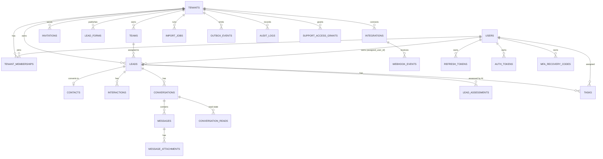

# Database Schema

Database design for the **AI Sales Assistant CRM**: one **PostgreSQL 16** database, shared tables, `tenant_id` on every tenant-owned row, isolated by **Row-Level Security (RLS)**, managed with **SQLAlchemy 2 + Alembic**.

> **Status:** target schema for the 15-day MVP. The current scaffold implements only `tenants`, `users`, `tenant_memberships`, `teams` and `audit_logs`; the rest is the agreed blueprint to build against.
>
> **Normative documents:** [`guide.txt`](./guide.txt) · [`PRODUCT_REQUIREMENTS.md`](./PRODUCT_REQUIREMENTS.md) · [`SECURITY.md`](./SECURITY.md) · [`API_CONTRACT.md`](./API_CONTRACT.md) · [`ARCHITECTURE.md`](./ARCHITECTURE.md) · [`CONTRIBUTING.md`](./CONTRIBUTING.md)
>
> **Security rule:** any migration that touches tenancy, RLS, auth or webhooks needs the ring reviewer **plus** the security approver (Dev 1, or Dev 4 if Dev 1 is the author). No exceptions.

**Legend**

| Mark | Meaning |
| --- | --- |
| ✅ | Specified by the project guide |
| 🔶 | Proposed to fill a gap; confirm in the Day 1 schema review |
| ⚠️ | Security-sensitive: review before merging |

---

## Table of contents

1. [Design principles](#1-design-principles)
2. [Entity overview and module ownership](#2-entity-overview-and-module-ownership)
3. [Conventions](#3-conventions)
4. [Identity and tenancy](#4-identity-and-tenancy)
5. [Auth, invitations and sessions](#5-auth-invitations-and-sessions)
6. [Leads, CRM and tasks](#6-leads-crm-and-tasks)
7. [Conversations and messages](#7-conversations-and-messages)
8. [AI assessments](#8-ai-assessments)
9. [Integrations, webhooks and events](#9-integrations-webhooks-and-events)
10. [Audit and platform administration](#10-audit-and-platform-administration)
11. [Enumerations](#11-enumerations)
12. [Composite foreign keys](#12-composite-foreign-keys)
13. [Row-Level Security](#13-row-level-security)
14. [Indexes](#14-indexes)
15. [Database roles](#15-database-roles)
16. [Migrations and seed data](#16-migrations-and-seed-data)
17. [Retention, backup and deletion](#17-retention-backup-and-deletion)
18. [Open questions](#18-open-questions)
19. [Cross-document alignment](#19-cross-document-alignment)

---

## 1. Design principles

1. **PostgreSQL is the system of record.** If it is not in the database, it did not happen.
2. **Every tenant-owned row has `tenant_id NOT NULL`**, and RLS enforces isolation even if application code forgets a filter.
3. **Never trust a `tenant_id` from the browser.** The backend verifies membership, then sets the tenant for the transaction.
4. **Composite foreign keys include `tenant_id`**, so a row in Company A can never reference a row in Company B.
5. **Deny by default.** RLS enabled with no matching policy means no access.
6. **The LLM never writes data.** AI output is validated, then stored in `lead_assessments` by backend code with the model and prompt version.
7. **n8n never touches this database.** It uses the internal API only.
8. **One capture pipeline for every channel.** Webhooks are deduplicated in `webhook_events`; messages by a unique provider message ID.
9. **Writes that can be retried are idempotent.** Use `idempotency_keys`, unique business keys, and `webhook_events`.
10. **PII is minimized, encrypted where required, and never logged.** Integration credentials are encrypted at rest; attachments stay private.

### Schema decisions at a glance

| Topic | Decision |
| --- | --- |
| Tenancy | Shared schema, `tenant_id` + RLS; no database-per-tenant in the MVP |
| Primary keys | `uuid` with `gen_random_uuid()` |
| Enums | `text` + `CHECK` constraints, not native PostgreSQL enums |
| Timestamps | `timestamptz`, stored in UTC; tenant timezone in `tenants.timezone` |
| Roles | Short strings: `rep`, `manager`, `admin` (matches current code and API contract) |
| Soft delete | Not the default; deactivate users/memberships; deletion is an explicit retention process |
| Secrets | `bytea` encrypted with a KMS/secrets-manager key; never returned by the API |
| Files | Private S3-compatible objects; database stores metadata and storage keys only |
| Events | Transactional `outbox_events`; no Redis in the MVP |
| Auth sessions | `refresh_tokens`, `auth_tokens`, `mfa_recovery_codes` |
| Optimistic concurrency | `version integer` on `leads` and `tasks` |
| Current scaffold gap | `DATABASE_URL` currently uses `crm_owner`; the API must use a non-owner `crm_app` role before Day 3 |

---

## 2. Entity overview and module ownership



| Table | Backend module | Purpose | RLS |
| --- | --- | --- | --- |
| `tenants` | `tenants` | Company accounts | Special |
| `users` | `auth` | Global user identity | Special (global) |
| `tenant_memberships` | `tenants` | User ↔ company + role/team | ✅ |
| `teams` | `tenants` | Sales teams in a company | ✅ |
| `invitations` | `users` / `auth` | Invite-only joining | ✅ |
| `refresh_tokens` | `auth` | Refresh rotation and revocation | Special (pre-tenant) |
| `auth_tokens` | `auth` | Password reset and email verification | Special (pre-tenant) |
| `mfa_recovery_codes` | `auth` | Hashed one-time MFA recovery codes | Special (global) |
| `auth_attempts` 🔶 | `auth` | Login rate limiting and audit | Special (global) |
| `leads` | `leads` | Lead details, source, status, owner, score | ✅ |
| `assignment_cursors` | `leads` | Team-scoped round-robin assignment position | ✅ |
| `contacts` ✅ | `leads` | Customer record after conversion | ✅ |
| `interactions` | `leads` | Notes, calls, form submits, timeline events | ✅ |
| `lead_forms` 🔶 | `integrations` | Public website form definitions | ✅ |
| `conversations` | `conversations` | WhatsApp/Messenger threads | ✅ |
| `conversation_reads` 🔶 | `conversations` | Per-user read state/unread count | ✅ |
| `messages` | `conversations` | Individual messages | ✅ |
| `message_attachments` 🔶 | `conversations` | Private attachment metadata | ✅ |
| `lead_assessments` | `ai` | Validated AI output and review state | ✅ |
| `tasks` | `tasks` | Calls, meetings, reminders, follow-ups | ✅ |
| `integrations` | `integrations` | Connected accounts and encrypted credentials | ✅ |
| `webhook_events` | `integrations` | Incoming events, dedup and processing state | ✅ |
| `import_jobs` 🔶 | `leads` | Async CSV import status/report | ✅ |
| `outbox_events` 🔶 | `core` (worker) | Transactional events for AI/n8n | ✅ |
| `idempotency_keys` 🔶 | `core` | Replay protection for retryable writes | ✅ |
| `audit_logs` | `audit` | Security and important user actions | Special |
| `support_access_grants` 🔶 | `tenants` / platform | Time-limited support access | Special |

---

## 3. Conventions

| Topic | Convention |
| --- | --- |
| Primary keys | `id uuid PRIMARY KEY DEFAULT gen_random_uuid()` |
| Tenant column | `tenant_id uuid NOT NULL` on every tenant-owned table; references `tenants(id)` `ON DELETE RESTRICT` unless noted |
| Tenant uniqueness | Every tenant table exposes `UNIQUE (tenant_id, id)` so children can use composite FKs |
| Timestamps | `timestamptz`; `created_at` on all tables; `updated_at` on mutable tables |
| Naming | `snake_case`, plural table names, SQLAlchemy naming convention from `backend/app/database/base.py` |
| Enumerations | `text` + `CHECK`, easier to migrate than native enums |
| Money / counts | Not used in the MVP |
| Soft delete | Not used by default; deactivate users/memberships; retention job handles real deletion |
| PII columns | `name`, `email`, `phone`, `message_text`; never log them; redact before LLM calls |
| Phone numbers | 🔶 Normalize to E.164 before storing and deduplicating |
| Emails | Lower-case before storing; enforce with `CHECK (email = lower(email))` |
| `jsonb` | Settings/metadata only; never store secrets or unredacted provider payloads |
| Encrypted secrets | `bytea`; encryption key lives in KMS/secrets manager, never in the database |
| IP addresses | `inet` where possible; `text` is acceptable for existing scaffolding |
| Optimistic concurrency | `version integer NOT NULL DEFAULT 1` on `leads` and `tasks`; increments on update |
| Idempotency | `idempotency_keys` table; unique business keys; `webhook_events` dedup |
| Foreign keys | `ON DELETE RESTRICT` by default; `SET NULL` only for optional references; no blanket cascades |
| Indexes | Start every tenant index with `tenant_id` |
| Time zone | Store UTC; `tenants.timezone` defaults to `Asia/Dhaka` for quiet hours/dashboards |

---

## 4. Identity and tenancy

### `tenants` ✅ (columns 🔶)

A company account.

| Column | Type | Notes |
| --- | --- | --- |
| `id` | uuid PK | |
| `name` | text NOT NULL | Company name |
| `slug` | text NOT NULL UNIQUE | URL-safe identifier; lower-case |
| `status` | text NOT NULL DEFAULT `'active'` | `active`, `suspended`, `deleted` |
| `timezone` | text NOT NULL DEFAULT `'Asia/Dhaka'` | 🔶 Quiet hours and dashboard buckets |
| `settings` | jsonb NOT NULL DEFAULT `'{}'` | 🔶 Quiet hours, follow-up settings, round-robin toggle |
| `created_at` / `updated_at` | timestamptz | |

Constraints:

```sql
CHECK (status IN ('active','suspended','deleted')),
CHECK (slug = lower(slug))
```

### `users` ✅ (columns 🔶)

Global user identity. Company access comes from `tenant_memberships`.

| Column | Type | Notes |
| --- | --- | --- |
| `id` | uuid PK | |
| `email` | text NOT NULL UNIQUE | Lower-case |
| `password_hash` | text NOT NULL | **Argon2id** only; the real password is never stored |
| `full_name` | text | PII |
| `email_verified_at` | timestamptz | Email verification is required |
| `is_platform_admin` | boolean NOT NULL DEFAULT false | Platform-level flag; separate from company admin |
| `mfa_enabled` | boolean NOT NULL DEFAULT false | Required for company/platform admins |
| `mfa_secret_encrypted` | bytea | Encrypted TOTP secret |
| `is_active` | boolean NOT NULL DEFAULT true | Deactivation revokes access immediately |
| `last_login_at` | timestamptz | Matches the current model |
| `created_at` / `updated_at` | timestamptz | |

Constraints:

```sql
CHECK (email = lower(email))
```

> A user is global and can belong to multiple tenants. `X-Tenant-ID` selects the active membership; the backend verifies it on every request.

### `tenant_memberships` ✅ (columns 🔶)

Links a user to a company with a role.

| Column | Type | Notes |
| --- | --- | --- |
| `id` | uuid PK | |
| `tenant_id` | uuid NOT NULL FK → `tenants` | `ON DELETE RESTRICT` |
| `user_id` | uuid NOT NULL FK → `users` | `ON DELETE RESTRICT` |
| `role` | text NOT NULL | `rep`, `manager`, `admin` |
| `team_id` | uuid | FK → `teams` `(tenant_id, id)` |
| `is_active` | boolean NOT NULL DEFAULT true | Deactivation revokes access |
| `created_at` / `updated_at` | timestamptz | |

Constraints:

```sql
CHECK (role IN ('rep','manager','admin')),
UNIQUE (tenant_id, user_id),
UNIQUE (tenant_id, id),
FOREIGN KEY (tenant_id, team_id) REFERENCES teams (tenant_id, id)
```

> Platform admin is **not** a membership role. A company admin is never automatically a platform admin.
>
> MVP scope: **one optional team per membership**. Multi-team managers need a reviewed `team_memberships` join table, not a UI-only change.

### `teams` ✅ (columns 🔶)

| Column | Type | Notes |
| --- | --- | --- |
| `id` | uuid PK | |
| `tenant_id` | uuid NOT NULL FK → `tenants` | |
| `name` | text NOT NULL | |
| `manager_user_id` | uuid | 🔶 Manager of the team |
| `created_at` / `updated_at` | timestamptz | |

Constraints:

```sql
UNIQUE (tenant_id, id),
UNIQUE (tenant_id, name),
FOREIGN KEY (tenant_id, manager_user_id)
  REFERENCES tenant_memberships (tenant_id, user_id)
```

---

## 5. Auth, invitations and sessions

These tables mostly run **before a tenant context exists** (login, refresh, reset, invite). They must be accessed through narrow, reviewed queries. RLS details are in [§13](#13-row-level-security).

### `invitations` 🔶

| Column | Type | Notes |
| --- | --- | --- |
| `id` | uuid PK | |
| `tenant_id` | uuid NOT NULL FK → `tenants` | |
| `email` | text NOT NULL | Lower-case; must match at acceptance |
| `role` | text NOT NULL | `rep`, `manager`, `admin` |
| `team_id` | uuid | Optional team on acceptance |
| `token_hash` | text NOT NULL UNIQUE | Store only a hash, never the raw token |
| `invited_by_user_id` | uuid NOT NULL | FK → `users` |
| `expires_at` | timestamptz NOT NULL | 7 days |
| `accepted_at` | timestamptz | Single-use |
| `revoked_at` | timestamptz | Admin revoke |
| `created_at` | timestamptz NOT NULL | |

Constraints: `CHECK (role IN ('rep','manager','admin'))`, composite FK to `teams`.

### `refresh_tokens` 🔶

| Column | Type | Notes |
| --- | --- | --- |
| `id` | uuid PK | |
| `user_id` | uuid NOT NULL FK → `users` | |
| `tenant_id` | uuid | Last-used tenant for UX only; not an authorization claim |
| `token_hash` | text NOT NULL UNIQUE | Hash only |
| `family_id` | uuid NOT NULL | Groups a rotation chain; reuse revokes the family |
| `expires_at` | timestamptz NOT NULL | 30 days |
| `revoked_at` | timestamptz | Logout, password reset, deactivation |
| `replaced_by_id` | uuid | Rotation link |
| `user_agent` | text | Optional, for session display |
| `ip_address` | inet | Optional |
| `last_used_at` | timestamptz | |
| `created_at` | timestamptz NOT NULL | |

Indexes: `(user_id)`, `(family_id)`, `(token_hash)`.

### `auth_tokens` 🔶

Password reset and email verification.

| Column | Type | Notes |
| --- | --- | --- |
| `id` | uuid PK | |
| `user_id` | uuid NOT NULL FK → `users` | |
| `purpose` | text NOT NULL | `password_reset`, `email_verification` |
| `token_hash` | text NOT NULL UNIQUE | Hash only |
| `expires_at` | timestamptz NOT NULL | Short-lived |
| `used_at` | timestamptz | Single-use |
| `created_at` | timestamptz NOT NULL | |

Constraint: `CHECK (purpose IN ('password_reset','email_verification'))`.

### `mfa_recovery_codes` 🔶

| Column | Type | Notes |
| --- | --- | --- |
| `id` | uuid PK | |
| `user_id` | uuid NOT NULL FK → `users` | |
| `code_hash` | text NOT NULL | Hash only |
| `used_at` | timestamptz | One-time |
| `created_at` | timestamptz NOT NULL | |

### `auth_attempts` 🔶 (optional, but recommended)

Used for login rate limiting and security audit when the app runs more than one process.

| Column | Type | Notes |
| --- | --- | --- |
| `id` | uuid PK | |
| `email` | text | Lower-cased |
| `ip_address` | inet | |
| `success` | boolean NOT NULL | |
| `created_at` | timestamptz NOT NULL | |

Indexes: `(email, created_at)`, `(ip_address, created_at)`. Retain 30 days.

---

## 6. Leads, CRM and tasks

### `leads` ✅ (columns 🔶)

Core fields from the guide plus the fields required by the API contract.

| Column | Type | Notes |
| --- | --- | --- |
| `id` | uuid PK | |
| `tenant_id` | uuid NOT NULL FK → `tenants` | |
| `name` | text NOT NULL | PII |
| `email` | text | PII; lower-case |
| `phone` | text | PII; 🔶 E.164 |
| `company_name` | text | The lead's company, not the tenant |
| `source` | text NOT NULL DEFAULT `'manual'` | See [§11](#11-enumerations) |
| `source_campaign` | text | UTM or ad campaign |
| `external_id` | text | Provider ID used for dedup |
| `status` | text NOT NULL DEFAULT `'new'` | Pipeline stage |
| `lost_reason` | text | Required when `status = 'lost'` |
| `assigned_user_id` | uuid | FK → membership |
| `team_id` | uuid | FK → `teams` `(tenant_id, id)` |
| `intent` | text | Latest AI intent, copied from newest assessment |
| `lead_score` | smallint | 0–100 |
| `priority` | text NOT NULL DEFAULT `'medium'` | `low`, `medium`, `high` |
| `consent` | boolean NOT NULL DEFAULT false | Consent to be contacted |
| `consent_at` | timestamptz | 🔶 When consent was captured |
| `consent_source` | text | 🔶 `web_form`, `whatsapp`, `manual`, `import`, `api` |
| `opted_out` | boolean NOT NULL DEFAULT false | Blocks outbound messages |
| `opted_out_at` | timestamptz | 🔶 |
| `opted_out_source` | text | Channel or actor that recorded the opt-out |
| `version` | integer NOT NULL DEFAULT 1 | Optimistic concurrency |
| `created_at` / `updated_at` | timestamptz | |

Constraints:

```sql
UNIQUE (tenant_id, id),
CHECK (source IN ('website_form','tracking','whatsapp','facebook_lead_ads','messenger','manual','csv')),
CHECK (status IN ('new','contacted','qualified','proposal','won','lost')),
CHECK (status <> 'lost' OR lost_reason IS NOT NULL),
CHECK (lost_reason IS NULL OR lost_reason IN ('price','timing','no_response','competitor','not_qualified','other')),
CHECK (priority IN ('low','medium','high')),
CHECK (intent IS NULL OR intent IN ('request_demo','pricing','support','info','complaint','other','unknown')),
CHECK (consent_source IS NULL OR consent_source IN ('web_form','whatsapp','manual','import','api')),
CHECK (NOT opted_out OR opted_out_at IS NOT NULL),
CHECK (lead_score IS NULL OR lead_score BETWEEN 0 AND 100),
CHECK (email IS NOT NULL OR phone IS NOT NULL),
CHECK (email IS NULL OR email = lower(email))
```

🔶 Dedup support (find-or-create by email / phone / external ID):

```sql
CREATE UNIQUE INDEX leads_tenant_source_external_uq
  ON leads (tenant_id, source, external_id)
  WHERE external_id IS NOT NULL;

CREATE INDEX leads_tenant_email_idx ON leads (tenant_id, lower(email));
CREATE INDEX leads_tenant_phone_idx ON leads (tenant_id, phone);
```

> Email and phone are matched by **lookup**, not a hard unique constraint, because one person can legitimately appear twice and phone formats vary. The capture service decides when to merge.

### `contacts` ✅ (columns 🔶)

Customer record after a lead is converted.

| Column | Type | Notes |
| --- | --- | --- |
| `id` | uuid PK | |
| `tenant_id` | uuid NOT NULL | |
| `lead_id` | uuid NOT NULL | Originating lead |
| `name` | text | PII |
| `email` | text | PII |
| `phone` | text | PII |
| `company_name` | text | |
| `created_at` / `updated_at` | timestamptz | |

Constraint: `UNIQUE (tenant_id, lead_id)`; composite FK to `leads`.

### `interactions` ✅ (columns 🔶)

Notes, calls, form submits, and other timeline events.

| Column | Type | Notes |
| --- | --- | --- |
| `id` | uuid PK | |
| `tenant_id` | uuid NOT NULL | |
| `lead_id` | uuid NOT NULL | Composite FK → `leads` |
| `type` | text NOT NULL | `form_submit`, `page_view`, `pricing_view`, `demo_request`, `call`, `note`, `status_change`, `assigned`, `opt_out`, `import` |
| `source` | text | Channel |
| `metadata` | jsonb NOT NULL DEFAULT `'{}'` | UTM, page URL, form fields; minimal PII |
| `occurred_at` | timestamptz NOT NULL | |
| `created_by_user_id` | uuid | Null for system/public events |
| `created_at` | timestamptz NOT NULL | |

Constraint: `CHECK (type IN ('form_submit','page_view','pricing_view','demo_request','call','note','status_change','assigned','opt_out','import'))`.

Together with `messages`, `tasks`, and `lead_assessments`, this feeds `GET /api/v1/leads/{id}/timeline`.

### `tasks` ✅ (columns 🔶)

Calls, meetings, reminders and follow-ups. A follow-up can require approval before n8n sends it.

| Column | Type | Notes |
| --- | --- | --- |
| `id` | uuid PK | |
| `tenant_id` | uuid NOT NULL | |
| `lead_id` | uuid NOT NULL | Composite FK → `leads` |
| `title` | text NOT NULL | Short task title |
| `notes` | text | Rep instructions / context; PII |
| `type` | text NOT NULL | `call`, `meeting`, `reminder`, `follow_up` |
| `status` | text NOT NULL DEFAULT `'open'` | `open`, `done`, `cancelled`, `paused` |
| `due_at` | timestamptz NOT NULL | Drives due/overdue queries |
| `assigned_user_id` | uuid | Composite FK → membership |
| `team_id` | uuid | Optional team scope; composite FK → `teams` |
| `requires_approval` | boolean NOT NULL DEFAULT false | Follow-up needs approval |
| `approval_status` | text NOT NULL DEFAULT `'not_required'` | `not_required`, `pending`, `approved`, `rejected` |
| `approved_by_user_id` | uuid | Composite FK → membership |
| `approved_at` | timestamptz | |
| `approval_note` | text | Reviewer note |
| `rejected_by_user_id` | uuid | Composite FK → membership |
| `rejected_at` | timestamptz | Explicit rejection signal for the API |
| `completed_at` | timestamptz | Set when `status = 'done'` |
| `created_by` | text NOT NULL DEFAULT `'user'` | `user`, `system`, `automation` |
| `idempotency_key` | text | Producer-side dedup |
| `version` | integer NOT NULL DEFAULT 1 | Optimistic concurrency |
| `created_at` / `updated_at` | timestamptz | |

Constraints:

```sql
UNIQUE (tenant_id, id),
CHECK (type IN ('call','meeting','reminder','follow_up')),
CHECK (status IN ('open','done','cancelled','paused')),
CHECK (approval_status IN ('not_required','pending','approved','rejected')),
CHECK (created_by IN ('user','system','automation')),
CHECK ((status = 'done') = (completed_at IS NOT NULL)),
CHECK (
  (requires_approval = false AND approval_status = 'not_required')
  OR (requires_approval = true AND approval_status IN ('pending','approved','rejected'))
),
CHECK (approval_status <> 'approved'
  OR (approved_by_user_id IS NOT NULL AND approved_at IS NOT NULL)),
CHECK (approval_status <> 'rejected'
  OR (rejected_by_user_id IS NOT NULL AND rejected_at IS NOT NULL))
```

Partial unique index for retryable creates:

```sql
CREATE UNIQUE INDEX tasks_tenant_idempotency_uq
  ON tasks (tenant_id, idempotency_key)
  WHERE idempotency_key IS NOT NULL;
```

`approval_status` is stored for filtering and the API response. The service must keep it consistent with `requires_approval` and the reviewer fields when approving or rejecting. Approval does **not** bypass consent, opt-out, quiet hours, or lead-status checks. Those rules stay in the workflow/API layer.

### `assignment_cursors`

Stores the last assigned member for each tenant team so round-robin assignment can advance transactionally.

| Column | Type | Notes |
| --- | --- | --- |
| `id` | uuid PK | |
| `tenant_id` | uuid NOT NULL | |
| `team_id` | uuid NOT NULL | Composite FK → `teams` |
| `last_assigned_user_id` | uuid | Composite FK → tenant membership; null before the first assignment |
| `created_at` / `updated_at` | timestamptz | |

Constraints: `UNIQUE (tenant_id, team_id)`; RLS restricts all operations to the active tenant.

### `lead_forms` 🔶

Public website form definitions behind `POST /api/v1/public/forms/{form_id}/submit`.

| Column | Type | Notes |
| --- | --- | --- |
| `id` | uuid PK | |
| `tenant_id` | uuid NOT NULL | |
| `public_id` | text NOT NULL UNIQUE | Opaque, unguessable public identifier |
| `name` | text NOT NULL | Internal name |
| `allowed_fields` | jsonb NOT NULL DEFAULT `'{}'` | Which fields are accepted |
| `consent_text` | text | Displayed consent text/version |
| `is_active` | boolean NOT NULL DEFAULT true | |
| `created_at` / `updated_at` | timestamptz | |

Public form lookup happens **before** tenant context; use the `app.public_form_id` pre-tenant lookup policy (see [§13](#13-row-level-security)).

### `import_jobs` 🔶

Async CSV import status and duplicate/error report.

| Column | Type | Notes |
| --- | --- | --- |
| `id` | uuid PK | |
| `tenant_id` | uuid NOT NULL | |
| `user_id` | uuid NOT NULL | Who started the import |
| `status` | text NOT NULL DEFAULT `'queued'` | `queued`, `processing`, `completed`, `failed` |
| `dry_run` | boolean NOT NULL DEFAULT false | Validate only |
| `total_rows` | integer NOT NULL DEFAULT 0 | |
| `created_count` | integer NOT NULL DEFAULT 0 | |
| `duplicate_count` | integer NOT NULL DEFAULT 0 | |
| `error_count` | integer NOT NULL DEFAULT 0 | |
| `errors` | jsonb NOT NULL DEFAULT `'[]'` | Capped at 100 entries |
| `file_reference` | text | Private storage key |
| `created_at` | timestamptz NOT NULL | |
| `completed_at` | timestamptz | |

Constraint: `CHECK (status IN ('queued','processing','completed','failed'))`.

---

## 7. Conversations and messages

### `conversations` ✅ (columns 🔶)

A chat thread on WhatsApp, Messenger, or a future channel.

| Column | Type | Notes |
| --- | --- | --- |
| `id` | uuid PK | |
| `tenant_id` | uuid NOT NULL | |
| `lead_id` | uuid NOT NULL | Composite FK → `leads` |
| `channel` | text NOT NULL | MVP: `whatsapp`, `messenger`; future: `email`, `web` |
| `external_conversation_id` | text | Provider thread ID |
| `status` | text NOT NULL DEFAULT `'open'` | `open`, `pending`, `closed` |
| `assigned_user_id` | uuid | Optional owner |
| `last_message_at` | timestamptz | Inbox ordering |
| `last_inbound_at` | timestamptz | WhatsApp 24-hour window rule |
| `created_at` / `updated_at` | timestamptz | |

Constraints:

```sql
UNIQUE (tenant_id, id),
CHECK (channel IN ('whatsapp','messenger','email','web')),
CHECK (status IN ('open','pending','closed'))
```

Partial unique index for provider threads:

```sql
CREATE UNIQUE INDEX conversations_tenant_channel_external_uq
  ON conversations (tenant_id, channel, external_conversation_id)
  WHERE external_conversation_id IS NOT NULL;
```

### `conversation_reads` 🔶

Per-user read state; used to compute `unread_count` without storing a per-user counter on the conversation.

| Column | Type | Notes |
| --- | --- | --- |
| `id` | uuid PK | |
| `tenant_id` | uuid NOT NULL | |
| `conversation_id` | uuid NOT NULL | Composite FK → `conversations` |
| `user_id` | uuid NOT NULL | Composite FK → membership |
| `last_read_at` | timestamptz NOT NULL | |
| `created_at` / `updated_at` | timestamptz | |

Constraint: `UNIQUE (tenant_id, conversation_id, user_id)`.

`unread_count` is computed, not stored:

```sql
SELECT count(*)
FROM messages m
LEFT JOIN conversation_reads r
  ON r.tenant_id = m.tenant_id
 AND r.conversation_id = m.conversation_id
 AND r.user_id = :current_user_id
WHERE m.tenant_id = :tenant_id
  AND m.conversation_id = :conversation_id
  AND m.direction = 'inbound'
  AND m.created_at > COALESCE(r.last_read_at, '-infinity'::timestamptz);
```

### `messages` ✅ (columns 🔶)

| Column | Type | Notes |
| --- | --- | --- |
| `id` | uuid PK | |
| `tenant_id` | uuid NOT NULL | |
| `conversation_id` | uuid NOT NULL | Composite FK → `conversations` |
| `provider` | text NOT NULL | 🔶 Resolves the guide's unique-index gap: `whatsapp`, `messenger` |
| `provider_message_id` | text | Provider's message ID; used for dedup |
| `direction` | text NOT NULL | `inbound`, `outbound` |
| `message_text` | text | PII; never log |
| `attachment_reference` | text | Legacy/single attachment key; new code uses `message_attachments` |
| `status` | text NOT NULL DEFAULT `'received'` | `received`, `queued`, `sent`, `delivered`, `read`, `failed` |
| `sent_at` | timestamptz | |
| `delivered_at` | timestamptz | |
| `read_at` | timestamptz | |
| `error_code` | text | Redacted provider error |
| `created_at` / `updated_at` | timestamptz | |

Constraints:

```sql
UNIQUE (tenant_id, id),
UNIQUE (tenant_id, provider, provider_message_id),
CHECK (provider IN ('whatsapp','messenger')),
CHECK (direction IN ('inbound','outbound')),
CHECK (status IN ('received','queued','sent','delivered','read','failed'))
```

> The guide's `messages` column list has no `provider`; this schema adds it so the required unique index `(tenant_id, provider, provider_message_id)` is valid. That open question is now resolved. Inbound messages start as `received`; outbound messages start as `queued` and move to `sent`/`delivered`/`read`/`failed` from provider callbacks.

### `message_attachments` 🔶

Private attachment metadata. The binary lives in S3-compatible storage, never in PostgreSQL.

| Column | Type | Notes |
| --- | --- | --- |
| `id` | uuid PK | |
| `tenant_id` | uuid NOT NULL | |
| `message_id` | uuid NOT NULL | Composite FK → `messages` |
| `storage_key` | text NOT NULL UNIQUE | Private object key |
| `filename` | text NOT NULL | Sanitized display name |
| `content_type` | text NOT NULL | Allow-list on upload |
| `size_bytes` | bigint NOT NULL | Max 10 MB |
| `checksum_sha256` | text | Integrity check |
| `created_at` | timestamptz NOT NULL | |

---

## 8. AI assessments

### `lead_assessments` ✅ (columns 🔶)

Stores one validated AI assessment per run. The AI advises; deterministic backend rules decide actions.

| Column | Type | Notes |
| --- | --- | --- |
| `id` | uuid PK | |
| `tenant_id` | uuid NOT NULL | |
| `lead_id` | uuid NOT NULL | Composite FK → `leads` |
| `conversation_id` | uuid | Optional trigger context |
| `category` | text | e.g. `business_customer` |
| `intent` | text | `request_demo`, `pricing`, `support`, `info`, `complaint`, `other`, `unknown` |
| `interest` | text | e.g. `CRM software` |
| `buying_stage` | text | `awareness`, `consideration`, `decision`, `unknown` |
| `sentiment` | text | `positive`, `neutral`, `negative` |
| `priority` | text | `low`, `medium`, `high` |
| `lead_score` | smallint | 0–100 |
| `recommended_action` | text | `schedule_demo`, `call`, `email`, `follow_up`, `support`, `none` |
| `follow_up_days` | smallint | |
| `confidence` | numeric(3,2) | 0.00–1.00 |
| `needs_human_review` | boolean NOT NULL DEFAULT false | True when confidence < 0.6 or fallback |
| `review_status` | text NOT NULL DEFAULT `'not_required'` | `not_required`, `pending`, `approved`, `rejected` |
| `reviewed_by_user_id` | uuid | Member who reviewed |
| `reviewed_at` | timestamptz | |
| `review_note` | text | |
| `summary` | text | Conversation summary |
| `model` | text NOT NULL | Model identifier |
| `prompt_version` | text NOT NULL | Prompt version |
| `raw_output` | jsonb | Validated JSON; no unredacted PII |
| `status` | text NOT NULL DEFAULT `'ok'` | `ok`, `fallback`, `failed` |
| `created_at` | timestamptz NOT NULL | |

Constraints:

```sql
CHECK (category IS NULL OR category IN ('business_customer','individual','partner','spam','unknown')),
CHECK (intent IS NULL OR intent IN ('request_demo','pricing','support','info','complaint','other','unknown')),
CHECK (buying_stage IS NULL OR buying_stage IN ('awareness','consideration','decision','unknown')),
CHECK (priority IS NULL OR priority IN ('low','medium','high')),
CHECK (recommended_action IS NULL OR recommended_action IN ('call','schedule_demo','email','follow_up','support','none')),
CHECK (follow_up_days IS NULL OR follow_up_days BETWEEN 0 AND 365),
CHECK (confidence BETWEEN 0 AND 1),
CHECK (lead_score BETWEEN 0 AND 100),
CHECK (sentiment IN ('positive','neutral','negative')),
CHECK (status IN ('ok','fallback','failed')),
CHECK (review_status IN ('not_required','pending','approved','rejected')),
CHECK (needs_human_review = false OR review_status <> 'not_required'),
CHECK (review_status NOT IN ('approved','rejected')
  OR (reviewed_by_user_id IS NOT NULL AND reviewed_at IS NOT NULL))
```

The newest assessment's `intent`, `lead_score` and `priority` are copied onto `leads` for fast list filtering. The assessment row remains the source of truth.

---

## 9. Integrations, webhooks and events

### `integrations` ✅ (columns 🔶)

For each integration the guide requires: **connector, provider account ID, scopes, expiry and encrypted credentials**.

| Column | Type | Notes |
| --- | --- | --- |
| `id` | uuid PK | |
| `tenant_id` | uuid NOT NULL | |
| `provider` | text NOT NULL | `whatsapp`, `meta`, `website_form`; future: `hubspot`, `salesforce` |
| `connected_by_user_id` | uuid | Who connected it; matches `API_CONTRACT.md` |
| `provider_account_id` | text | WhatsApp phone number ID, Meta page ID |
| `scopes` | text[] NOT NULL DEFAULT `'{}'` | Granted scopes |
| `credentials_encrypted` | bytea NOT NULL | Encrypted; never returned by any API |
| `status` | text NOT NULL DEFAULT `'active'` | `active`, `revoked`, `error`; `expired` is derived from `expires_at` |
| `expires_at` | timestamptz | Token expiry |
| `last_verified_at` | timestamptz | 🔶 Last successful provider check |
| `last_error` | text | Redacted error only |
| `created_at` / `updated_at` | timestamptz | |

Constraints:

```sql
UNIQUE (provider, provider_account_id),
CHECK (provider IN ('whatsapp','meta','website_form','hubspot','salesforce')),
CHECK (status IN ('active','revoked','error'))
```

### `webhook_events` ✅ (columns 🔶)

Incoming provider events, deduplication, and retry state.

| Column | Type | Notes |
| --- | --- | --- |
| `id` | uuid PK | |
| `tenant_id` | uuid NOT NULL | Resolved from the integration before insert |
| `integration_id` | uuid NOT NULL | Composite FK → `integrations` |
| `provider` | text NOT NULL | `whatsapp`, `meta` |
| `external_event_id` | text NOT NULL | Provider event or message ID |
| `signature_valid` | boolean NOT NULL | Must be true; invalid signatures are rejected before insert |
| `payload` | jsonb | Minimal payload; PII-minimized; retention-limited |
| `status` | text NOT NULL DEFAULT `'received'` | `received`, `processing`, `processed`, `failed`, `ignored` |
| `attempts` | smallint NOT NULL DEFAULT 0 | |
| `last_error` | text | Redacted |
| `received_at` | timestamptz NOT NULL | |
| `processed_at` | timestamptz | |
| `next_attempt_at` | timestamptz | Retry scheduling |
| `locked_at` | timestamptz | Worker claim |

```sql
UNIQUE (provider, external_event_id),
CHECK (provider IN ('whatsapp','meta')),
CHECK (signature_valid),
CHECK (status IN ('received','processing','processed','failed','ignored'))
```

`UNIQUE (provider, external_event_id)` is global dedup and prevents replay across tenants. If a provider event ID is only unique per tenant, change it to `(tenant_id, provider, external_event_id)` in the Day 1 review.

### `outbox_events` 🔶

Transactional outbox for AI jobs and n8n events. An event exists only if the business transaction committed.

| Column | Type | Notes |
| --- | --- | --- |
| `id` | uuid PK | Event ID |
| `tenant_id` | uuid NOT NULL | |
| `event_type` | text NOT NULL | See [§11](#11-enumerations) |
| `aggregate_type` | text NOT NULL | `lead`, `conversation`, `message`, `task`, `assessment`, `integration` |
| `aggregate_id` | uuid NOT NULL | No polymorphic FK |
| `payload` | jsonb NOT NULL DEFAULT `'{}'` | IDs and minimal metadata only; no PII |
| `idempotency_key` | text | Producer-side dedup |
| `status` | text NOT NULL DEFAULT `'pending'` | `pending`, `processing`, `processed`, `failed`, `dead` |
| `attempts` | smallint NOT NULL DEFAULT 0 | |
| `available_at` | timestamptz NOT NULL DEFAULT now() | Backoff scheduling |
| `locked_at` | timestamptz | Worker claim |
| `locked_by` | text | Worker ID |
| `last_error` | text | Redacted |
| `created_at` | timestamptz NOT NULL | |
| `processed_at` | timestamptz | |

```sql
CHECK (status IN ('pending','processing','processed','failed','dead')),
CHECK (aggregate_type IN ('lead','conversation','message','task','assessment','integration'))
```

Partial unique index for producer dedup:

```sql
CREATE UNIQUE INDEX outbox_tenant_idempotency_uq
  ON outbox_events (tenant_id, idempotency_key)
  WHERE idempotency_key IS NOT NULL;
```

### `idempotency_keys` 🔶

Replay protection for retryable user and service writes.

| Column | Type | Notes |
| --- | --- | --- |
| `id` | uuid PK | |
| `tenant_id` | uuid NOT NULL | |
| `caller_type` | text NOT NULL | `user`, `service` |
| `caller_id` | text NOT NULL | User UUID as text, or a service identity such as `n8n` |
| `method` | text NOT NULL | HTTP method |
| `path` | text NOT NULL | Route path |
| `key` | text NOT NULL | Client `Idempotency-Key` |
| `request_hash` | text NOT NULL | Hash of normalized body |
| `response_status` | smallint | Stored response |
| `response_body` | jsonb | Stored response; cap at 64 KB |
| `created_at` | timestamptz NOT NULL | |
| `expires_at` | timestamptz NOT NULL | 24 hours |

```sql
UNIQUE (tenant_id, caller_type, caller_id, method, path, key),
CHECK (caller_type IN ('user','service'))
```

---

## 10. Audit and platform administration

### `audit_logs` ✅ (columns 🔶)

Security and important user actions. **Append-only**: the app role may `INSERT` and `SELECT`, but not `UPDATE` or `DELETE`.

| Column | Type | Notes |
| --- | --- | --- |
| `id` | uuid PK | |
| `tenant_id` | uuid | Null for platform-level events |
| `actor_user_id` | uuid | Null for system actions |
| `actor_type` | text NOT NULL | `user`, `system`, `automation`, `platform_admin` |
| `action` | text NOT NULL | e.g. `auth.login`, `user.role_changed`, `lead.assigned` |
| `entity_type` | text | |
| `entity_id` | uuid | No polymorphic FK |
| `ip_address` | inet | |
| `user_agent` | text | Matches the current model |
| `request_id` | text | Correlates with application logs |
| `details` | jsonb NOT NULL DEFAULT `'{}'` | **No passwords, tokens, credentials, or message bodies** |
| `created_at` | timestamptz NOT NULL | |

Constraint: `CHECK (actor_type IN ('user','system','automation','platform_admin'))`.

Indexes: `(tenant_id, created_at)`, `(actor_user_id)`.

> The current model calls this column `details`; the API contract exposes `details`. Keep the name consistent. Do not introduce `metadata` for the same field.

### `support_access_grants` 🔶

Temporary, approved, logged platform-admin access to tenant data. Not part of the normal tenant API.

| Column | Type | Notes |
| --- | --- | --- |
| `id` | uuid PK | |
| `tenant_id` | uuid NOT NULL | |
| `platform_user_id` | uuid NOT NULL | Who gets access |
| `reason` | text NOT NULL | Why |
| `approved_by_user_id` | uuid NOT NULL | Second platform admin |
| `starts_at` | timestamptz NOT NULL | |
| `expires_at` | timestamptz NOT NULL | Maximum 60 minutes |
| `revoked_at` | timestamptz | |
| `created_at` | timestamptz NOT NULL | |

Constraints:

```sql
FOREIGN KEY (tenant_id) REFERENCES tenants (id),
FOREIGN KEY (platform_user_id) REFERENCES users (id),
FOREIGN KEY (approved_by_user_id) REFERENCES users (id),
CHECK (expires_at > starts_at),
CHECK (expires_at <= starts_at + interval '60 minutes')
```

Every use is written to `audit_logs`. If this flow is not built by Day 15, the production-readiness checklist item for support access remains open and must be documented.

---

## 11. Enumerations

Stored as `text` with `CHECK` constraints.

| Field | Allowed values |
| --- | --- |
| `tenants.status` | `active`, `suspended`, `deleted` |
| `tenant_memberships.role` | `rep`, `manager`, `admin` |
| `invitations.role` | `rep`, `manager`, `admin` |
| `leads.source` ✅ | `website_form`, `tracking`, `whatsapp`, `facebook_lead_ads`, `messenger`, `manual`, `csv` |
| `leads.status` ✅ | `new`, `contacted`, `qualified`, `proposal`, `won`, `lost` |
| `leads.priority` ✅ | `low`, `medium`, `high` |
| `leads.lost_reason` 🔶 | `price`, `timing`, `no_response`, `competitor`, `not_qualified`, `other` |
| `leads.intent` 🔶 | `request_demo`, `pricing`, `support`, `info`, `complaint`, `other`, `unknown` |
| `leads.consent_source` 🔶 | `web_form`, `whatsapp`, `manual`, `import`, `api` |
| `interactions.type` 🔶 | `form_submit`, `page_view`, `pricing_view`, `demo_request`, `call`, `note`, `status_change`, `assigned`, `opt_out`, `import` |
| `conversations.channel` ✅ | `whatsapp`, `messenger`; future: `email`, `web` |
| `conversations.status` 🔶 | `open`, `pending`, `closed` |
| `messages.provider` 🔶 | `whatsapp`, `messenger` |
| `messages.direction` ✅ | `inbound`, `outbound` |
| `messages.status` 🔶 | `received`, `queued`, `sent`, `delivered`, `read`, `failed` |
| `lead_assessments.category` 🔶 | `business_customer`, `individual`, `partner`, `spam`, `unknown` |
| `lead_assessments.buying_stage` 🔶 | `awareness`, `consideration`, `decision`, `unknown` |
| `lead_assessments.recommended_action` 🔶 | `call`, `schedule_demo`, `email`, `follow_up`, `support`, `none` |
| `lead_assessments.sentiment` ✅ | `positive`, `neutral`, `negative` |
| `lead_assessments.status` 🔶 | `ok`, `fallback`, `failed` |
| `lead_assessments.review_status` 🔶 | `not_required`, `pending`, `approved`, `rejected` |
| `tasks.type` 🔶 | `call`, `meeting`, `reminder`, `follow_up` |
| `tasks.status` 🔶 | `open`, `done`, `cancelled`, `paused` |
| `tasks.approval_status` 🔶 | `not_required`, `pending`, `approved`, `rejected` |
| `tasks.created_by` 🔶 | `user`, `system`, `automation` |
| `integrations.provider` ✅ | `whatsapp`, `meta`, `website_form`; future: `hubspot`, `salesforce` |
| `integrations.status` 🔶 | `active`, `revoked`, `error`; `expired` is derived |
| `webhook_events.provider` 🔶 | `whatsapp`, `meta` |
| `webhook_events.status` 🔶 | `received`, `processing`, `processed`, `failed`, `ignored` |
| `outbox_events.event_type` 🔶 | `lead.created`, `lead.assigned`, `message.received`, `message.sent`, `lead.replied`, `task.due`, `assessment.completed`, `integration.error` |
| `outbox_events.status` 🔶 | `pending`, `processing`, `processed`, `failed`, `dead` |
| `import_jobs.status` 🔶 | `queued`, `processing`, `completed`, `failed` |
| `auth_tokens.purpose` 🔶 | `password_reset`, `email_verification` |
| `audit_logs.actor_type` 🔶 | `user`, `system`, `automation`, `platform_admin` |
| `support_access_grants` | No enum; validated by API |

**Pipeline:** `new → contacted → qualified → proposal → won | lost`. Moving to `lost` requires a `lost_reason`.

---

## 12. Composite foreign keys

Every tenant table exposes `UNIQUE (tenant_id, id)`. Children reference parent **and** `tenant_id`. The Alembic base migration adds this unique constraint to every tenant table; the SQL below only shows the parents used by child foreign keys.

> The `UNIQUE (tenant_id, id)` lines shown inline in the table sections and the `ALTER TABLE ... UNIQUE` lines below are the **same constraint**. Implement each once; this block is consolidated for review, not a second copy.

```sql
-- Parents
ALTER TABLE leads ADD CONSTRAINT leads_tenant_id_id_uq UNIQUE (tenant_id, id);
ALTER TABLE teams ADD CONSTRAINT teams_tenant_id_id_uq UNIQUE (tenant_id, id);
ALTER TABLE conversations ADD CONSTRAINT conversations_tenant_id_id_uq UNIQUE (tenant_id, id);
ALTER TABLE messages ADD CONSTRAINT messages_tenant_id_id_uq UNIQUE (tenant_id, id);
ALTER TABLE integrations ADD CONSTRAINT integrations_tenant_id_id_uq UNIQUE (tenant_id, id);
ALTER TABLE tenant_memberships ADD CONSTRAINT memberships_tenant_user_uq UNIQUE (tenant_id, user_id);

-- Leads
ALTER TABLE leads
  ADD CONSTRAINT leads_team_fk
  FOREIGN KEY (tenant_id, team_id) REFERENCES teams (tenant_id, id);

ALTER TABLE leads
  ADD CONSTRAINT leads_assignee_fk
  FOREIGN KEY (tenant_id, assigned_user_id)
  REFERENCES tenant_memberships (tenant_id, user_id);

-- Tasks
ALTER TABLE tasks ADD CONSTRAINT tasks_tenant_id_id_uq UNIQUE (tenant_id, id);

ALTER TABLE tasks
  ADD CONSTRAINT tasks_lead_fk
  FOREIGN KEY (tenant_id, lead_id) REFERENCES leads (tenant_id, id);

ALTER TABLE tasks
  ADD CONSTRAINT tasks_assignee_fk
  FOREIGN KEY (tenant_id, assigned_user_id)
  REFERENCES tenant_memberships (tenant_id, user_id);

ALTER TABLE tasks
  ADD CONSTRAINT tasks_team_fk
  FOREIGN KEY (tenant_id, team_id) REFERENCES teams (tenant_id, id);

ALTER TABLE tasks
  ADD CONSTRAINT tasks_approver_fk
  FOREIGN KEY (tenant_id, approved_by_user_id)
  REFERENCES tenant_memberships (tenant_id, user_id);

ALTER TABLE tasks
  ADD CONSTRAINT tasks_rejecter_fk
  FOREIGN KEY (tenant_id, rejected_by_user_id)
  REFERENCES tenant_memberships (tenant_id, user_id);

-- Conversations and messages
ALTER TABLE conversations
  ADD CONSTRAINT conversations_lead_fk
  FOREIGN KEY (tenant_id, lead_id) REFERENCES leads (tenant_id, id);

ALTER TABLE conversations
  ADD CONSTRAINT conversations_assignee_fk
  FOREIGN KEY (tenant_id, assigned_user_id)
  REFERENCES tenant_memberships (tenant_id, user_id);

ALTER TABLE conversation_reads
  ADD CONSTRAINT conversation_reads_conversation_fk
  FOREIGN KEY (tenant_id, conversation_id)
  REFERENCES conversations (tenant_id, id);

ALTER TABLE conversation_reads
  ADD CONSTRAINT conversation_reads_user_fk
  FOREIGN KEY (tenant_id, user_id)
  REFERENCES tenant_memberships (tenant_id, user_id);

ALTER TABLE messages
  ADD CONSTRAINT messages_conversation_fk
  FOREIGN KEY (tenant_id, conversation_id)
  REFERENCES conversations (tenant_id, id);

ALTER TABLE message_attachments
  ADD CONSTRAINT attachments_message_fk
  FOREIGN KEY (tenant_id, message_id) REFERENCES messages (tenant_id, id);

-- AI
ALTER TABLE lead_assessments
  ADD CONSTRAINT assessments_lead_fk
  FOREIGN KEY (tenant_id, lead_id) REFERENCES leads (tenant_id, id);

ALTER TABLE lead_assessments
  ADD CONSTRAINT assessments_conversation_fk
  FOREIGN KEY (tenant_id, conversation_id)
  REFERENCES conversations (tenant_id, id);

ALTER TABLE lead_assessments
  ADD CONSTRAINT assessments_reviewer_fk
  FOREIGN KEY (tenant_id, reviewed_by_user_id)
  REFERENCES tenant_memberships (tenant_id, user_id);

-- Interactions, contacts and imports
ALTER TABLE interactions
  ADD CONSTRAINT interactions_lead_fk
  FOREIGN KEY (tenant_id, lead_id) REFERENCES leads (tenant_id, id);

ALTER TABLE interactions
  ADD CONSTRAINT interactions_creator_fk
  FOREIGN KEY (tenant_id, created_by_user_id)
  REFERENCES tenant_memberships (tenant_id, user_id);

ALTER TABLE contacts
  ADD CONSTRAINT contacts_lead_fk
  FOREIGN KEY (tenant_id, lead_id) REFERENCES leads (tenant_id, id);

ALTER TABLE import_jobs
  ADD CONSTRAINT imports_user_fk
  FOREIGN KEY (tenant_id, user_id) REFERENCES tenant_memberships (tenant_id, user_id);

-- Invitations, integrations and webhooks
ALTER TABLE invitations
  ADD CONSTRAINT invitations_team_fk
  FOREIGN KEY (tenant_id, team_id) REFERENCES teams (tenant_id, id);

ALTER TABLE integrations
  ADD CONSTRAINT integrations_connector_fk
  FOREIGN KEY (tenant_id, connected_by_user_id)
  REFERENCES tenant_memberships (tenant_id, user_id);

ALTER TABLE webhook_events
  ADD CONSTRAINT webhook_events_integration_fk
  FOREIGN KEY (tenant_id, integration_id) REFERENCES integrations (tenant_id, id);
```

Rules:

- `users` is global; references go through `tenant_memberships (tenant_id, user_id)`.
- Optional references use `MATCH SIMPLE` and are only checked when non-null.
- Use `ON DELETE RESTRICT` for business data. Do not cascade tenant-owned rows.
- Polymorphic references (`audit_logs.entity_id`, `outbox_events.aggregate_id`) intentionally have no FK; validate in the service layer.

---

## 13. Row-Level Security

Rules:

- `ENABLE` **and** `FORCE ROW LEVEL SECURITY` on every tenant-owned table.
- No matching policy means access is denied.
- The app role is a **non-superuser without `BYPASSRLS`**.
- The tenant comes from a verified transaction-local setting, never from client input.
- RLS isolates **tenants**, not roles. Rep/manager/admin scoping is application code, covered by role-scope tests.

### Standard policy

```sql
ALTER TABLE leads ENABLE ROW LEVEL SECURITY;
ALTER TABLE leads FORCE ROW LEVEL SECURITY;

CREATE POLICY leads_tenant_isolation ON leads
USING (tenant_id = NULLIF(current_setting('app.tenant_id', true), '')::uuid)
WITH CHECK (tenant_id = NULLIF(current_setting('app.tenant_id', true), '')::uuid);
```

Per transaction:

```sql
SELECT set_config('app.tenant_id', 'verified-tenant-uuid', true);
```

If the setting is unset or empty, `NULLIF` returns `NULL`, the comparison is never true, and **no rows are visible** (fail closed).

### Tenant tables that need this policy

`tenant_memberships`, `teams`, `invitations`, `leads`, `assignment_cursors`, `contacts`, `interactions`, `lead_forms`, `conversations`, `conversation_reads`, `messages`, `message_attachments`, `lead_assessments`, `tasks`, `integrations`, `webhook_events`, `import_jobs`, `outbox_events`, `idempotency_keys`, `audit_logs`, and `support_access_grants`. Any new table with `tenant_id` joins this list unless it has an entry in **Special cases** below.

### Special cases ⚠️

| Table | Why it differs | Handling |
| --- | --- | --- |
| `tenants` | The row's own `id` is the tenant | Policy on `id = current tenant`; signup sets `app.tenant_id` to the new tenant UUID before insert |
| `users` | Global identity, no `tenant_id` | No tenant RLS; the auth service queries by lower-case email, then by session user ID; never expose user lists without a membership check |
| `tenant_memberships` | A user must list their memberships **before** choosing a tenant | Pre-tenant `FOR SELECT` policy on `user_id = app.user_id`; standard tenant policy still applies for all other access |
| `invitations` | Accepting an invite looks up a token before tenant context exists | Pre-tenant `FOR SELECT` policy on `token_hash = app.invitation_token_hash`; verify the logged-in email before inserting the membership |
| `refresh_tokens`, `auth_tokens`, `mfa_recovery_codes`, `auth_attempts` | Auth runs before tenant context | No tenant RLS; query by token hash/user only; never expose cross-user |
| `webhook_events` | Event arrives before tenant is known | Verify signature → set `app.webhook_provider`/`app.webhook_account_id` → select the integration via a pre-tenant lookup policy → set tenant → insert |
| `lead_forms` | Public form lookup has no tenant | Set `app.public_form_id` → select the active form via a pre-tenant lookup policy → set tenant → process the submission |
| `outbox_events` | Worker must claim across tenants | `crm_worker` gets a policy on `outbox_events` only; payload contains IDs, no PII; set tenant before reading business tables |
| `audit_logs` | Platform events have no tenant | Tenant rows use standard policy; platform rows are written/read through a separate platform path |
| `support_access_grants` | Platform-level control | Platform-only policy; every use audited; no ordinary tenant-user access |

### Pre-tenant lookup policies

Use transaction-local settings and **narrow `FOR SELECT` policies**. The app role stays non-superuser and never gets `BYPASSRLS`. Enable and force RLS on these tables too; the policies below are additional permissive policies, not a replacement for tenant isolation.

```sql
-- Tenants: the active tenant, or tenants where the caller has a membership
CREATE POLICY tenants_tenant_isolation ON tenants
FOR ALL TO crm_app
USING (id = NULLIF(current_setting('app.tenant_id', true), '')::uuid)
WITH CHECK (id = NULLIF(current_setting('app.tenant_id', true), '')::uuid);

CREATE POLICY tenants_membership_lookup ON tenants
FOR SELECT TO crm_app
USING (
  id IN (
    SELECT tm.tenant_id
    FROM tenant_memberships tm
    WHERE tm.user_id = NULLIF(current_setting('app.user_id', true), '')::uuid
      AND tm.is_active
  )
);

-- Signup: set app.tenant_id to the new tenant UUID before the insert
-- Tenant selection: only the caller's own memberships
CREATE POLICY memberships_self_lookup ON tenant_memberships
FOR SELECT TO crm_app
USING (
  is_active
  AND user_id = NULLIF(current_setting('app.user_id', true), '')::uuid
);

-- Invitation acceptance: one token hash at a time
CREATE POLICY invitations_token_lookup ON invitations
FOR SELECT TO crm_app
USING (
  token_hash = NULLIF(current_setting('app.invitation_token_hash', true), '')
  AND expires_at > now()
  AND accepted_at IS NULL
  AND revoked_at IS NULL
);

-- Webhook tenant resolution: exactly one provider account
CREATE POLICY integrations_webhook_lookup ON integrations
FOR SELECT TO crm_app
USING (
  provider = NULLIF(current_setting('app.webhook_provider', true), '')
  AND provider_account_id = NULLIF(current_setting('app.webhook_account_id', true), '')
  AND status = 'active'
  AND (expires_at IS NULL OR expires_at > now())
);

-- Public form resolution: exactly one active public form
CREATE POLICY lead_forms_public_lookup ON lead_forms
FOR SELECT TO crm_app
USING (
  is_active
  AND public_id = NULLIF(current_setting('app.public_form_id', true), '')
);
```

Per request:

```sql
SELECT set_config('app.user_id', 'verified-user-uuid', true);
SELECT set_config('app.invitation_token_hash', 'sha256-of-raw-token', true);
SELECT set_config('app.webhook_provider', 'whatsapp', true);
SELECT set_config('app.webhook_account_id', 'phone-number-id', true);
SELECT set_config('app.public_form_id', 'opaque-form-id', true);
```

Rules:

- These settings are transaction-local and are set only after the relevant token/signature/route validation.
- The policies expose only the row needed for the lookup; after resolving the tenant, set `app.tenant_id` and re-query business data under the standard policy.
- `integrations_webhook_lookup` can see encrypted credentials because it reads the integration row. The service selects only `id` and `tenant_id` and never returns credentials.
- Do not use a broad `USING (true)` policy on a tenant table. If a lookup cannot be expressed safely as a policy, use the approved resolver-function fallback below.

```sql
-- Worker claim: outbox payloads contain IDs only, never PII
CREATE POLICY outbox_worker_claim ON outbox_events
FOR ALL TO crm_worker
USING (true)
WITH CHECK (true);
```

The worker must set `app.tenant_id` before reading or writing any other tenant table.

### Fallback `SECURITY DEFINER` rules

Prefer the pre-tenant lookup policies above. Use a function only when a policy cannot express the lookup safely (for example, a future platform flow).

- Owner is a dedicated `crm_resolver` role: `NOLOGIN`, `BYPASSRLS`, no login/API grants; it owns only the narrow function and has the minimum `SELECT` that function needs. Do **not** use `crm_migrator`; under `FORCE RLS` the table owner is still subject to RLS, so ownership alone does not bypass it.
- `SET search_path = public, pg_temp`.
- Return only the minimum fields.
- `REVOKE ALL FROM PUBLIC`; grant `EXECUTE` only to `crm_app`/`crm_worker`.
- No dynamic SQL.
- Add tests for cross-tenant attempts.
- Security approver reviews every function and the `crm_resolver` role itself.

### RLS coverage test

Add a CI test that fails if any **ordinary** tenant table with a `tenant_id` column lacks:

1. `relrowsecurity = true`
2. `relforcerowsecurity = true`
3. At least one policy
4. A policy referencing `current_setting('app.tenant_id', true)`

Tables in the **Special cases** table above use a documented allow-list with their own policy tests (`outbox_events`, `support_access_grants`, platform `audit_logs`). This catches the most common "forgot RLS" mistake without hiding real exceptions.

---

## 14. Indexes

Required by the guide ✅:

```sql
CREATE INDEX ON leads (tenant_id, created_at);
CREATE INDEX ON leads (tenant_id, assigned_user_id);
CREATE INDEX ON leads (tenant_id, status);
CREATE UNIQUE INDEX ON messages (tenant_id, provider, provider_message_id);
```

Proposed 🔶:

| Index | Supports |
| --- | --- |
| `leads (tenant_id, team_id)` | Manager team views |
| `leads (tenant_id, priority)` | Priority filters, rep dashboard |
| `leads (tenant_id, source)` | Leads by source |
| `leads (tenant_id, lower(email))` | Dedup lookup |
| `leads (tenant_id, phone)` | Dedup lookup |
| `leads (tenant_id, source, external_id) WHERE external_id IS NOT NULL` UNIQUE | Provider dedup |
| `teams (tenant_id, name)` UNIQUE | Team names |
| `tenant_memberships (tenant_id, user_id)` UNIQUE | Membership lookup |
| `tenant_memberships (tenant_id, team_id)` | Team membership |
| `invitations (tenant_id, email)` | Pending invites |
| `refresh_tokens (user_id)` / `(family_id)` / `(token_hash)` | Session rotation/revocation |
| `auth_tokens (token_hash)` UNIQUE | Reset/verification |
| `mfa_recovery_codes (user_id)` | MFA recovery |
| `auth_attempts (email, created_at)` / `(ip_address, created_at)` | Login rate limiting |
| `tasks (tenant_id, assigned_user_id, due_at) WHERE status = 'open'` | Today / overdue / upcoming |
| `tasks (tenant_id, status, due_at)` | Manager/admin task lists |
| `tasks (tenant_id, lead_id, due_at)` | Lead follow-ups |
| `conversations (tenant_id, status, last_message_at DESC)` | Inbox by status |
| `conversations (tenant_id, assigned_user_id, last_message_at DESC)` | Assigned inbox |
| `conversation_reads (tenant_id, user_id, last_read_at)` | Unread counts |
| `messages (tenant_id, conversation_id, created_at)` | Message thread |
| `messages (tenant_id, provider, provider_message_id)` UNIQUE | Dedup |
| `message_attachments (tenant_id, message_id)` | Message attachments |
| `interactions (tenant_id, lead_id, occurred_at)` | Timeline |
| `lead_assessments (tenant_id, lead_id, created_at DESC)` | Latest assessment |
| `lead_assessments (tenant_id, needs_human_review, created_at) WHERE needs_human_review` | Human-review queue |
| `lead_forms (public_id)` UNIQUE | Public form lookup |
| `import_jobs (tenant_id, created_at DESC)` | Import history |
| `integrations (provider, provider_account_id)` UNIQUE | Webhook tenant resolution |
| `webhook_events (provider, external_event_id)` UNIQUE | Dedup |
| `webhook_events (status, next_attempt_at)` | Retry worker |
| `outbox_events (status, available_at)` | Event worker |
| `outbox_events (tenant_id, created_at DESC)` | Tenant event history |
| `idempotency_keys (expires_at)` | Cleanup |
| `audit_logs (tenant_id, created_at)` | Audit review |
| `audit_logs (actor_user_id)` | Actor lookup |
| `support_access_grants (tenant_id, expires_at)` | Active grant lookup |

Every index on an ordinary tenant table starts with `tenant_id`. The documented global lookup/dedup indexes (`integrations`, `lead_forms`, `webhook_events`, auth tables) and worker queue indexes (`webhook_events`, `outbox_events`) are intentional exceptions. Verify with query plans on Day 13; remove unused indexes.

---

## 15. Database roles

| Role | Used by | Permissions |
| --- | --- | --- |
| `crm_app` | FastAPI API | **Non-superuser, no `BYPASSRLS`.** CRUD on tenant tables under RLS. `INSERT`/`SELECT` on `audit_logs`; no `DELETE` on `tenants` or `audit_logs`. No access to `support_access_grants` except through the platform path. Execute approved lookup functions. |
| `crm_worker` | Background worker | **Non-superuser, no `BYPASSRLS`.** Claim/update `outbox_events`; CRUD on tenant tables under RLS after setting `app.tenant_id`. |
| `crm_migrator` (owner) | Alembic migrations | Owns tables. `FORCE ROW LEVEL SECURITY` still applies. Not used by the app. |
| `crm_resolver` (only if approved) | `SECURITY DEFINER` fallback lookups | `NOLOGIN`, `BYPASSRLS`, no login/API grants; owns only narrowly reviewed functions with the minimum `SELECT` they need. Never used as a connection role. Prefer pre-tenant lookup policies instead. |
| `crm_admin` | Operators / break-glass | Separate credentials; not used by the application. |
| `crm_backup` | Backups/restore | Read-only dump access; separate credentials. |
| `n8n` | n8n's **own workflow database** | **No access to the CRM database.** n8n reaches CRM data only through the internal API. |

Rules:

- Separate credentials for app, worker, migrator, admin and backup. `crm_resolver` is `NOLOGIN` and has no credentials.
- The app/worker roles must not own tables and must not have `BYPASSRLS`.
- Prefer the pre-tenant lookup policies in [§13](#13-row-level-security); `crm_resolver` is a reviewed fallback only.
- `crm_worker` may read `outbox_events` across tenants only because the payload contains IDs and event metadata, not PII. It must set `app.tenant_id` before touching business tables.
- Never deploy with `DATABASE_URL` pointing at `crm_owner`. The current scaffold does; split it before the Day 3 checkpoint.
- Rotate credentials and keep them in a secrets manager, never in the repository.

---

## 16. Migrations and seed data

### Migration order

1. Extensions/utilities (`gen_random_uuid()` is available in PostgreSQL 16).
2. Identity/tenancy: `tenants`, `users`, `teams`, `tenant_memberships`.
3. Auth: `invitations`, `refresh_tokens`, `auth_tokens`, `mfa_recovery_codes`, `auth_attempts`.
4. Leads: `leads`, `contacts`, `interactions`, `lead_forms`, `import_jobs`.
5. Conversations: `conversations`, `conversation_reads`, `messages`, `message_attachments`.
6. AI: `lead_assessments`.
7. Tasks: `tasks`.
8. Integrations/events: `integrations`, `webhook_events`, `outbox_events`, `idempotency_keys`.
9. Audit/platform: `audit_logs`, `support_access_grants`.
10. RLS policies, pre-tenant lookup policies, approved resolver functions (if any), indexes, and seed data.

### Migration checklist

Every migration that creates a tenant table must include, in the same PR; later changes must preserve them:

- [ ] `tenant_id uuid NOT NULL`
- [ ] `UNIQUE (tenant_id, id)`
- [ ] Composite foreign keys
- [ ] `ENABLE` + `FORCE ROW LEVEL SECURITY`
- [ ] Tenant isolation policy
- [ ] Indexes starting with `tenant_id` (or a documented global/worker exception)
- [ ] RLS coverage test update
- [ ] Security approver review

Rules:

- **Announce in chat before creating a migration** to avoid Alembic multiple heads.
- Rebase/merge `develop` before generating a revision.
- Migrations must be forward-compatible: deploy schema before code that requires it; use expand/contract for breaking changes.
- Do not run migrations automatically on every API start; use a one-off migration job in deployment.
- Day 1 may create models/tables; Day 3 adds RLS. No tenant table is deployed to staging/production and no tenant data endpoint is merged before the RLS migration lands.

### Seed data

Day 1 deliverable: **2 companies with 5 users each**, giving every developer two tenants to test isolation.

| Tenant | Users |
| --- | --- |
| Company A | 1 `admin`, 1 `manager`, 3 `rep` |
| Company B | 1 `admin`, 1 `manager`, 3 `rep` |

Seed also needs:

- 2 teams per company.
- Sample leads, conversations, messages, tasks and assessments.
- One public `lead_form` for the website form flow.
- Fixed UUIDs for cross-tenant tests.
- No real PII, credentials, or provider tokens.

The seed script must be idempotent and safe to run repeatedly in local/staging. Because RLS is forced, it sets `app.tenant_id` to the new tenant's ID before inserting that tenant and its rows.

---

## 17. Retention, backup and deletion

| Data | Retention / handling |
| --- | --- |
| `webhook_events.payload` | 30 days, then purge payload; keep dedup ID/status if needed |
| `outbox_events` processed rows | 30 days |
| `idempotency_keys` | 24 hours (`expires_at`) |
| `auth_attempts` | 30 days |
| `import_jobs.file_reference` | Delete the uploaded file 7 days after completion; keep the job summary/errors |
| `audit_logs` | 1 year minimum; longer if required by policy |
| `messages` / attachments | Per tenant policy; no automatic deletion in the MVP |
| `lead_assessments.raw_output` | Minimize PII; purge with the lead/tenant |
| n8n execution data | 7–14 days; minimal PII |
| Application/n8n logs | 30 days; never contain passwords, tokens or message bodies |

Backup and deletion:

- Encrypted, off-server backups; restore is tested, not assumed.
- No public database port in staging/production.
- Tenant export and deletion script covers all tenant tables, S3 objects, and backups according to policy.
- Deletion order respects `ON DELETE RESTRICT`: children first, then `leads`, `tenant_memberships`, `teams`, `tenants`.
- Audit the export/delete action.
- Never delete `audit_logs` outside the retention process.

---

## 18. Open questions

Resolved by this revision:

- **Role values:** short strings `rep`, `manager`, `admin` (matches code and API contract).
- **Messages `provider`:** added to `messages`; unique index is valid.
- **Webhook dedup:** global `(provider, external_event_id)`; revisit only if a provider proves per-tenant IDs.
- **Dedup policy:** lookup-and-merge for email/phone; hard unique for `(tenant_id, source, external_id)`.
- **Multi-tenant users:** supported through `tenant_memberships`; `X-Tenant-ID` selects the active membership.
- **Token storage:** refresh token in `HttpOnly` cookie, access token in memory, CSRF token; see `API_CONTRACT.md`.
- **AI assessment ownership:** FastAPI capture service owns the initial assessment job; n8n orchestrates idempotently.
- **Events:** PostgreSQL `outbox_events`, no Redis in the MVP.

Still to confirm in the Day 1 schema/security review:

1. **Pre-tenant lookups.** Confirm the `app.user_id`, `app.invitation_token_hash`, `app.webhook_*` and `app.public_form_id` policies; use the reviewed `crm_resolver` fallback only if a policy cannot express the lookup.
2. **Worker claim policy.** `crm_worker` policy on `outbox_events` vs an approved claim function.
3. **`users` / `tenants` RLS.** The narrow access path for login/signup and platform administration.
4. **Attachments.** File-type allow-list, malware scanning, and size limits.
5. **Support access.** Whether `support_access_grants` ships in the MVP or remains a documented post-MVP gap.
6. **`contacts`.** Whether lead-to-contact conversion is implemented in the MVP.
7. **Auth attempts.** DB-backed rate limiting vs an in-process/edge limit.
8. **Retention durations.** Final legal/product policy for messages, assessments, audit and backups.
9. **Platform admin model.** `users.is_platform_admin` flag vs a separate table.
10. **Partitioning.** `audit_logs` / `messages` partitioning is post-MVP unless volume requires it.
11. **Multi-team managers.** Keep one team per membership for the MVP or approve a `team_memberships` join table.

---

## 19. Cross-document alignment

| Topic | This schema | API contract | Current code | Action |
| --- | --- | --- | --- | --- |
| Roles | `rep`, `manager`, `admin` | Same | Same | None; keep in sync |
| Audit details | `audit_logs.details` | `details` | `details` | None |
| Optimistic concurrency | `leads.version`, `tasks.version` | Same | Missing | Add in first migrations |
| Task approval | `tasks.approval_status` + reviewer fields | `approval_status` | Missing | Add columns |
| Assessment review | `review_status`, reviewed fields | Same | Missing | Add columns |
| Message delivery | `messages.status` + timestamps | Same | Missing | Add columns |
| Conversation unread | `conversation_reads` table | `unread_count` computed | Missing | Implement read table |
| CSV import | `import_jobs` | `POST /leads/import` + status | Missing | Add table/job |
| Events | `outbox_events` | Internal/n8n events | Missing | Add table/worker |
| Idempotency | `idempotency_keys` | `Idempotency-Key` | Missing | Add table/middleware |
| Public forms | `lead_forms` | `POST /public/forms/{form_id}/submit` | Missing | Add table/lookup policy |
| Attachments | `message_attachments` | Signed download URLs | Missing | Add table/storage |
| Auth | `refresh_tokens`, `auth_tokens`, MFA tables | Login/refresh/MFA endpoints | Partial models | Add in Day 2 |
| Current DB role | `crm_app` target | API uses `X-Tenant-ID` | `.env` uses `crm_owner` | Split before Day 3 |

---

*Related documents: [README.md](./README.md) · [PRODUCT_REQUIREMENTS.md](./PRODUCT_REQUIREMENTS.md) · [SECURITY.md](./SECURITY.md) · [API_CONTRACT.md](./API_CONTRACT.md) · [ARCHITECTURE.md](./ARCHITECTURE.md) · [CONTRIBUTING.md](./CONTRIBUTING.md) · [guide.txt](./guide.txt)*
