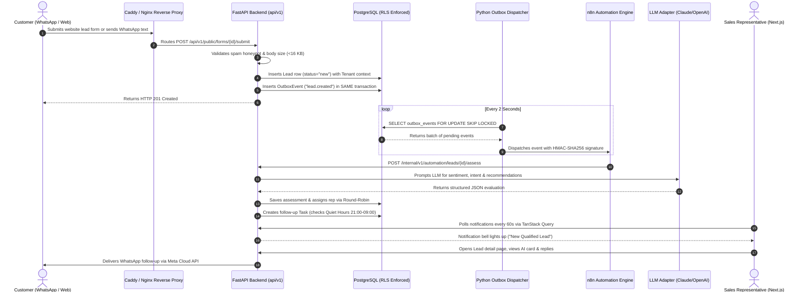

# Syntrix AI Sales CRM: Complete Maintenance & Operations Guide

> **Authoritative Guide:** This document provides everything needed to understand, run, maintain, troubleshoot, and modify the Syntrix CRM platform. It is written in plain language so that anyone—from a newcomer to an experienced engineer—can maintain the system safely and confidently.

---

## Table of Contents

- [Layer 1: The High-Level Overview (Read in One Sitting)](#layer-1-the-high-level-overview)
  - [1.1 What the System Does](#11-what-the-system-does)
  - [1.2 The System Architecture & Moving Parts](#12-the-system-architecture--moving-parts)
  - [1.3 The Life of an Inquiry: End-to-End Request Flow](#13-the-life-of-an-inquiry-end-to-end-request-flow)
  - [1.4 Quick File & Service Directory](#14-quick-file--service-directory)
- [Layer 2: Detailed Maintenance & Change Procedures](#layer-2-detailed-maintenance--change-procedures)
  - [2.1 Changing WhatsApp Accounts, Numbers, or Credentials](#21-changing-whatsapp-accounts-numbers-or-credentials)
  - [2.2 Changing Facebook Page / Meta Messenger Connections](#22-changing-facebook-page--meta-messenger-connections)
  - [2.3 Changing Database Passwords & Credentials](#23-changing-database-passwords--credentials)
  - [2.4 Changing LLM Models, Providers, or API Keys](#24-changing-llm-models-providers-or-api-keys)
  - [2.5 Resetting User Passwords](#25-resetting-user-passwords)
  - [2.6 Setting Up or Resetting MFA (Multi-Factor Authentication)](#26-setting-up-or-resetting-mfa-multi-factor-authentication)
  - [2.7 Changing Environment Variables, n8n Secrets, and S3 Storage Keys](#27-changing-environment-variables-n8n-secrets-and-s3-storage-keys)
- [Layer 3: Routine Operations & Health Checks](#layer-3-routine-operations--health-checks)
  - [3.1 Scheduled Checklist (Daily, Weekly, Monthly)](#31-scheduled-checklist-daily-weekly-monthly)
  - [3.2 How to Read Logs & Spot Early Warnings](#32-how-to-read-logs--spot-early-warnings)
  - [3.3 Restarting, Redeploying & Applying Alembic Migrations](#33-restarting-redeploying--applying-alembic-migrations)
- [Layer 4: Troubleshooting & Emergency Fixes](#layer-4-troubleshooting--emergency-fixes)
  - [4.1 "The request could not be completed" or Login Failures](#41-the-request-could-not-be-completed-or-login-failures)
  - [4.2 Expired JWTs, Refresh Token Rotation & Session Replay Rejections](#42-expired-jwts-refresh-token-rotation--session-replay-rejections)
  - [4.3 Database RLS (Row-Level Security) Query Rejections & 403 Errors](#43-database-rls-row-level-security-query-rejections--403-errors)
  - [4.4 Failed Alembic Migrations & Multiple Heads](#44-failed-alembic-migrations--multiple-heads)
  - [4.5 n8n Workflow Failures & Dead Outbox Events](#45-n8n-workflow-failures--dead-outbox-events)
  - [4.6 LLM Output Failing Pydantic Schema Validation](#46-llm-output-failing-pydantic-schema-validation)
  - [4.7 Reverse Proxy TLS & SSL Certificate Renewal](#47-reverse-proxy-tls--ssl-certificate-renewal)
- [Layer 5: Security Habits & Golden Rules](#layer-5-security-habits--golden-rules)
- [Glossary of Technical Terms](#glossary-of-technical-terms)

---

# Layer 1: The High-Level Overview

## 1.1 What the System Does

Syntrix CRM is an **AI-powered, multi-tenant sales assistant**. It solves a universal sales problem: customer inquiries pour in from websites, WhatsApp, and Facebook at all hours of the day. Without automation, inquiries get lost, response times take hours, and sales reps waste time qualifying bad leads.

Syntrix automates the entire sales funnel:
1. **Captures Inquiries**: Listens to public website forms, WhatsApp messages, and Facebook Lead Ads.
2. **Evaluates Intent with AI**: Reads customer messages, detects buying intent, scores sentiment, and recommends what the sales rep should do next.
3. **Assigns Sales Reps**: Uses fair round-robin scheduling within teams.
4. **Enforces Respectful Follow-ups**: Follows local Bangladesh business hours (**Quiet Hours**: 21:00 to 09:00 Asia/Dhaka) and pauses automated reminders immediately when a customer replies.
5. **Enforces Strict Privacy (Multi-Tenancy)**: Different companies (e.g. Acme Traders vs. Globex Interiors) share the same application, but **PostgreSQL Row-Level Security (RLS)** makes it physically impossible for Company A to view or query Company B's data.

---

## 1.2 The System Architecture & Moving Parts

The platform consists of seven core components working together in Docker containers:

```text
 ┌────────────────────────────────────────────────────────────────────────┐
 │ 1. REVERSE PROXY (Caddy / Nginx)                                       │
 │    • Terminates HTTPS / TLS certificates                               │
 │    • Routes /api/* to backend:8000; all other traffic to frontend:3000 │
 └──────────────────────┬─────────────────────────┬───────────────────────┘
                        │                         │
                        ▼                         ▼
 ┌──────────────────────────────┐       ┌─────────────────────────────────┐
 │ 2. FRONTEND (Next.js 15)     │       │ 3. BACKEND API (FastAPI)        │
 │    • React, TypeScript       │       │    • Python 3.12, Uvicorn       │
 │    • Tailwind CSS & shadcn/ui│       │    • SQLAlchemy 2 ORM           │
 │    • TanStack Query caching  │       │    • Pydantic v2 validation     │
 │    • In-memory token store   │       │    • Tenant context injection   │
 └──────────────────────────────┘       └───────────────┬─────────────────┘
                                                        │
                        ┌───────────────────────────────┴─────────────────┐
                        ▼                                                 ▼
 ┌──────────────────────────────┐       ┌─────────────────────────────────┐
 │ 4. DATABASE (PostgreSQL 16)  │       │ 5. AUTOMATION (n8n Engine)      │
 │    • Row-Level Security (RLS)│       │    • Workflow A (New Lead)      │
 │    • Dedicated crm_app role  │       │    • Workflow B (Follow-up)     │
 │    • Isolated schemas        │       │    • Workflow C (Reply Pause)   │
 └──────────────┬───────────────┘       └────────────────┬────────────────┘
                │                                        │
                ▼                                        ▼
 ┌──────────────────────────────┐       ┌─────────────────────────────────┐
 │ 6. BACKGROUND WORKERS        │       │ 7. AI ENGINE (LLM Adapter)      │
 │    • Dispatcher (Outbox)     │       │    • Claude / OpenAI models     │
 │    • Requeue Dead Event Loop │       │    • PII redaction              │
 └──────────────────────────────┘       └─────────────────────────────────┘
```

---

## 1.3 The Life of an Inquiry: End-to-End Request Flow

Here is the exact journey of a lead from the outside world into the sales rep's inbox:



---

## 1.4 Quick File & Service Directory

| Path | Purpose | Key Responsibilities |
| :--- | :--- | :--- |
| `backend/app/main.py` | FastAPI Application Entry | App initialization, middleware, CORS, routers mount, error handlers |
| `backend/app/core/config.py` | Settings & Environment Config | Reads `.env`, parses tokens, encryption keys, and environment toggles |
| `backend/app/core/tenancy.py` | Multi-Tenant Security Guard | Extracts tenant ID, verifies membership, executes `SELECT set_config('app.tenant_id', ...)` |
| `backend/app/core/permissions.py` | RBAC & Role Verification | Role checks (`rep`, `manager`, `admin`, `require_platform_admin` + MFA) |
| `backend/app/core/outbox.py` | Outbox Event Generator | Atomic event insertion within the same database transaction as business rows |
| `backend/app/core/dispatcher.py` | Outbox Event Poller | Claims pending events using `FOR UPDATE SKIP LOCKED` and sends to n8n |
| `backend/app/modules/ai/` | Artificial Intelligence Concierge | LLM adapters (Anthropic/OpenAI/Fake), prompt formatting, PII stripping |
| `backend/app/modules/integrations/` | Channel Connectors | WhatsApp API, Meta webhook verification, AES-256-GCM credential encryption |
| `backend/app/modules/tasks/` | Task & Follow-up Service | Task scheduling, manager approvals, pause-on-reply event handling |
| `backend/app/modules/automation/` | Quiet Hours & Health | Bangladesh timezone calculation, quiet hours rescheduling (202 response) |
| `frontend/src/app/` | Next.js Page Routes | Dashboard (`/`), Leads (`/leads`), Tasks (`/tasks`), Conversations (`/conversations`), Settings (`/settings`), Integrations (`/integrations`) |
| `infrastructure/docker-compose.yml` | Multi-Container Setup | Runs `db`, `backend`, `worker`, `dispatcher`, `mailpit`, `n8n`, `n8n_db` |
| `n8n/workflows/` | Visual Automation Workflows | Workflow A (New Lead), Workflow B (Follow-up), Workflow C (Customer Reply), Sub-workflow (Sign & Call) |

---

# Layer 2: Detailed Maintenance & Change Procedures

Each procedure below follows a strict safety recipe: **Before you touch anything**, **Exact steps**, **How to confirm it worked**, and **How to rollback if it breaks**.

---

## 2.1 Changing WhatsApp Accounts, Numbers, or Credentials

WhatsApp credentials in Syntrix are **write-only**. Tokens are encrypted using AES-256-GCM before touching the database and are never displayed again or returned via the API.

### Before You Begin
1. Log in to the [Meta for Developers Portal](https://developers.facebook.com).
2. Navigate to your App > **WhatsApp** > **API Setup**.
3. Note your **Phone Number ID**, **WhatsApp Business Account (WABA) ID**, and generate a **Permanent System User Access Token** with `whatsapp_business_messaging` and `whatsapp_business_management` permissions.

### Option A: Using the Admin Web Dashboard (Recommended)
1. Open the CRM in your browser: `http://localhost:3000/integrations`.
2. Ensure you are signed in as an **Admin** user (`admin@acme.test`).
3. Under the **WhatsApp Business** card:
   - If already connected: Click **Update Token**.
   - If new: Click **Connect WhatsApp**.
4. In the modal:
   - **Phone Number ID**: Paste your numeric ID (e.g. `109283746501928`).
   - **Access Token**: Paste your permanent system user access token into the password field.
   - **WABA ID**: (Optional) Enter your WhatsApp Business Account ID.
5. Click **Save & Verify**.

### Option B: Using the Direct REST API
```bash
curl -X POST http://localhost:8000/api/v1/integrations/whatsapp/connect \
  -H "Authorization: Bearer <ADMIN_ACCESS_TOKEN>" \
  -H "X-Tenant-ID: <TENANT_UUID>" \
  -H "Content-Type: application/json" \
  -d '{
    "provider_account_id": "109283746501928",
    "access_token": "EAA...",
    "waba_id": "918273645019283",
    "scopes": ["messages", "webhooks"]
  }'
```

### Confirmation
1. Refresh `http://localhost:3000/integrations`. The WhatsApp card will display a green **Active** badge and display your Phone Number ID.
2. Send a WhatsApp test message from a real phone to your WhatsApp Business phone number.
3. Open `http://localhost:3000/conversations`. The message will appear at the top of the thread list.

### Rollback / If It Breaks
If you pasted an expired or invalid token:
1. Click **Disconnect** on the WhatsApp card in `/integrations`.
2. Confirm the disconnect dialog.
3. Re-enter a known valid token and Phone Number ID.

---

## 2.2 Changing Facebook Page / Meta Messenger Connections

Meta integration subscribes the CRM to your Facebook Page's `leadgen` and `messages` webhooks.

### Before You Begin
1. In Meta Business Suite, ensure your system user has full control over the target Facebook Page.
2. Generate a **Page Access Token** with `pages_manage_metadata`, `pages_read_engagement`, `leads_retrieval`, and `pages_messaging` permissions.
3. Note your numeric **Facebook Page ID**.

### Steps to Update
1. Navigate to `http://localhost:3000/integrations`.
2. Locate the **Meta (Facebook Lead Ads)** card.
3. Click **Connect Meta Page** (or **Update Token**).
4. Enter:
   - **Facebook Page ID (Numeric)**: e.g. `102938475610293` (Must be digits only).
   - **Page Access Token**: Paste the token into the write-only field.
5. Click **Save & Verify**.
   - The backend runs a validation call against `https://graph.facebook.com/v21.0/` and automatically calls `POST /{page_id}/subscribed_apps` to activate real-time webhooks.

### Confirmation
1. In Meta App Dashboard, navigate to **Webhooks** > **Page** > click **Test** on `leadgen`.
2. Open `http://localhost:3000/leads`. A new lead will appear in the table with source `meta_lead_ad`.

### Rollback
1. In the integrations page, click **Disconnect** on the Meta card.
2. The backend soft-disables the connection in the database (`status = 'disabled'`), halts processing, and records an audit log.

---

## 2.3 Changing Database Passwords & Credentials

Syntrix enforces the **Least Privilege Principle**. The database uses four separate PostgreSQL roles:
- `crm_owner`: Table owner used only for container setup.
- `crm_app`: Used by FastAPI (has `SELECT`, `INSERT`, `UPDATE` under forced RLS; `DELETE` is revoked).
- `crm_worker`: Used by the AI worker and dispatcher background services.
- `crm_migrator`: Used only when running `alembic upgrade`.

### Before You Begin
1. Back up the PostgreSQL database first:
   ```bash
   docker compose -f infrastructure/docker-compose.yml exec db pg_dump -U crm_owner crm > crm_backup_$(date +%F).sql
   ```
2. Note down your existing `.env` file values.

### Steps to Rotate Passwords
1. Open a PostgreSQL shell as superuser:
   ```bash
   docker compose -f infrastructure/docker-compose.yml exec -it db psql -U crm_owner -d crm
   ```
2. Update the passwords inside PostgreSQL:
   ```sql
   ALTER USER crm_app WITH PASSWORD 'NewSecretAppPassword123!';
   ALTER USER crm_worker WITH PASSWORD 'NewSecretWorkerPassword123!';
   ALTER USER crm_migrator WITH PASSWORD 'NewSecretMigratorPassword123!';
   \q
   ```
3. Update the matching connection strings in your root `.env` file:
   ```ini
   DATABASE_URL=postgresql+psycopg://crm_app:NewSecretAppPassword123!@db:5432/crm
   WORKER_DATABASE_URL=postgresql+psycopg://crm_worker:NewSecretWorkerPassword123!@db:5432/crm
   MIGRATION_DATABASE_URL=postgresql+psycopg://crm_migrator:NewSecretMigratorPassword123!@db:5432/crm
   ```
4. Restart the backend services to load the new credentials:
   ```bash
   docker compose -f infrastructure/docker-compose.yml restart backend worker dispatcher
   ```

### Confirmation
Check the backend health check:
```bash
curl http://localhost:8000/health
# Expected: {"status":"ok"}
```

### Rollback
If the backend logs display `password authentication failed`:
1. Re-open the PostgreSQL shell with `psql -U crm_owner -d crm`.
2. Alter the user back to the previous password.
3. Revert your `.env` file.

---

## 2.4 Changing LLM Models, Providers, or API Keys

The AI module ([backend/app/modules/ai/adapter.py](file:///e:/Sales%20assist/Sus/backend/app/modules/ai/adapter.py)) supports Anthropic (`claude-3-5-sonnet-20241022`), OpenAI (`gpt-4o-mini`), and a `fake` analyzer for offline testing.

### Before You Begin
Obtain an API key from [console.anthropic.com](https://console.anthropic.com) or [platform.openai.com](https://platform.openai.com).

### Steps to Change Model or Key
1. Open `.env` in the project root.
2. Modify the LLM configuration section:
   ```ini
   # For Anthropic Claude (Default):
   LLM_PROVIDER=anthropic
   LLM_API_KEY=sk-ant-api03-...
   LLM_MODEL=claude-3-5-sonnet-20241022
   LLM_BASE_URL=https://api.anthropic.com/v1/messages

   # For OpenAI:
   LLM_PROVIDER=openai
   LLM_API_KEY=sk-proj-...
   LLM_MODEL=gpt-4o-mini
   LLM_BASE_URL=https://api.openai.com/v1/chat/completions
   ```
3. To adjust AI review strictness, tune the confidence threshold (between 0.0 and 1.0):
   ```ini
   AI_REVIEW_CONFIDENCE_THRESHOLD=0.7
   ```
4. Restart the background worker:
   ```bash
   docker compose -f infrastructure/docker-compose.yml restart worker
   ```

### Confirmation
Run the AI evaluation verification test:
```bash
backend\backstore\Scripts\python.exe -m pytest backend/tests/unit/test_ai_adapter.py
```
Both Anthropic and OpenAI adapter tests will pass with `200 OK`.

---

## 2.5 Resetting User Passwords

Passwords in Syntrix use **Argon2id** with memory-hard parameters. Passwords are never stored in plain text.

### User Self-Service Reset (Standard)
1. User clicks **"Forgot password?"** on `http://localhost:3000/login`.
2. Enters their email address (`rep1@acme.test`).
3. The system generates a single-use token with a 30-minute expiration and emails a reset link.
4. If testing locally, open **Mailpit** at `http://localhost:8025` to view the simulated outgoing email.

### Administrator CLI Password Override (Emergency Reset)
If a user is locked out and cannot receive email:
1. Generate an Argon2id password hash using Python:
   ```powershell
   backend\backstore\Scripts\python.exe -c "from argon2 import PasswordHasher; print(PasswordHasher().hash('NewTemporaryPass123!'))"
   ```
2. Copy the resulting hash (starts with `$argon2id$...`).
3. Connect to the database and update the user:
   ```sql
   UPDATE users 
   SET password_hash = '$argon2id$...', updated_at = now() 
   WHERE email = 'user@example.com';

   -- Revoke all existing sessions immediately:
   UPDATE refresh_tokens 
   SET revoked_at = now() 
   WHERE user_id = (SELECT id FROM users WHERE email = 'user@example.com');
   ```
4. The user can now log in immediately with `NewTemporaryPass123!`.

---

## 2.6 Setting Up or Resetting MFA (Multi-Factor Authentication)

Company Admins and Platform Admins are **required** to use TOTP Multi-Factor Authentication.

### Setup Flow for an Admin
1. When an Admin logs in for the first time, the API returns:
   ```json
   { "mfa_setup_required": true, "setup_token": "..." }
   ```
2. The frontend directs the user to scan the QR code using Google Authenticator, 1Password, or Authy.
3. The user enters the 6-digit code to confirm.
4. The backend displays **10 single-use emergency recovery codes**. The admin must download or copy these.

### Emergency MFA Reset (When an Admin Loses Their Phone)
If an admin loses their authenticator device and has lost their recovery codes:
1. Connect to PostgreSQL:
   ```bash
   docker compose -f infrastructure/docker-compose.yml exec -it db psql -U crm_owner -d crm
   ```
2. Disable MFA and wipe the encrypted secret for that user:
   ```sql
   UPDATE users 
   SET mfa_enabled = false, 
       mfa_secret_encrypted = NULL, 
       mfa_last_used_step = NULL,
       updated_at = now()
   WHERE email = 'admin@acme.test';

   -- Clear all existing recovery codes:
   DELETE FROM mfa_recovery_codes 
   WHERE user_id = (SELECT id FROM users WHERE email = 'admin@acme.test');

   -- Revoke all active login sessions for security:
   UPDATE refresh_tokens 
   SET revoked_at = now() 
   WHERE user_id = (SELECT id FROM users WHERE email = 'admin@acme.test');
   ```
3. The admin can now log in with their email and password. Upon login, the system will prompt them to enroll a fresh authenticator device.

---

## 2.7 Changing Environment Variables, n8n Secrets, and S3 Storage Keys

All core application keys reside in `.env`.

### Critical Variables Table
| Variable Name | Purpose | What Breaks If Wrong | How to Generate Securely |
| :--- | :--- | :--- | :--- |
| `JWT_SECRET_KEY` | Signs access tokens | All users logged out instantly | `python -c "import secrets; print(secrets.token_urlsafe(48))"` |
| `MFA_ENCRYPTION_KEY` | Encrypts TOTP secrets (Fernet) | Existing MFA codes become undecryptable | `python -c "from cryptography.fernet import Fernet; print(Fernet.generate_key().decode())"` |
| `INTEGRATION_ENCRYPTION_KEY` | Encrypts WhatsApp tokens (AES-GCM) | Cannot send WhatsApp/Meta messages | `python -c "import base64, os; print(base64.b64encode(os.urandom(32)).decode())"` |
| `SERVICE_HMAC_SECRET` | Authenticates n8n → backend calls | n8n workflows get 401 Unauthorized | `python -c "import secrets; print(secrets.token_urlsafe(48))"` |
| `N8N_EVENT_SIGNING_SECRET` | Authenticates backend → n8n calls | Dispatcher webhook rejected by n8n | `python -c "import secrets; print(secrets.token_urlsafe(48))"` |
| `N8N_ENCRYPTION_KEY` | Encrypts n8n internal credential store | **Never change after first boot**; destroys n8n saved credentials | `python -c "import secrets; print(secrets.token_hex(32))"` |

---

# Layer 3: Routine Operations & Health Checks

## 3.1 Scheduled Checklist

### Daily Checks (2 Minutes)
1. **Platform Health Probe**:
   ```bash
   curl http://localhost:8000/health
   # Must return: {"status":"ok"}
   ```
2. **Check Dead Outbox Queue**:
   Check if any events failed permanently:
   ```sql
   SELECT count(*) FROM outbox_events WHERE status = 'dead';
   ```
   *If count > 0, run the requeue script (see Section 4.5).*

### Weekly Checks (10 Minutes)
1. **Container Health**:
   ```bash
   docker compose -f infrastructure/docker-compose.yml ps
   # All services should report (healthy) or Up.
   ```
2. **Database Disk Usage**:
   ```bash
   docker compose -f infrastructure/docker-compose.yml exec db df -h /var/lib/postgresql/data
   ```
3. **Audit Log Inspection**:
   Inspect recent administrative actions:
   ```sql
   SELECT action, actor_type, created_at FROM audit_logs ORDER BY created_at DESC LIMIT 15;
   ```

### Monthly Checks (30 Minutes)
1. **Backup Drill**:
   Take a snapshot and test restoring it to a scratch database (see Section 3.4).
2. **Dependency & Security Audit**:
   ```bash
   npm --prefix frontend audit
   backend\backstore\Scripts\python.exe -m pip list --outdated
   ```

---

## 3.2 How to Read Logs & Spot Early Warnings

Each service streams structured logs with request IDs.

### Reading Logs in Real Time
```bash
# Follow backend API logs:
docker compose -f infrastructure/docker-compose.yml logs -f --tail=100 backend

# Follow outbox dispatcher logs:
docker compose -f infrastructure/docker-compose.yml logs -f --tail=100 dispatcher

# Follow AI worker logs:
docker compose -f infrastructure/docker-compose.yml logs -f --tail=100 worker

# Follow n8n automation logs:
docker compose -f infrastructure/docker-compose.yml logs -f --tail=100 n8n
```

### What Healthy Logs Look Like
```text
INFO:     172.20.0.1:48392 - "GET /health HTTP/1.1" 200 OK
INFO:api.request:method=POST path=/api/v1/auth/login status=200 duration=0.082s request_id=8f2b...
INFO:dispatcher:claimed 1 outbox events; dispatched event_id=e7b4... to n8n status=200
```

### Warning Signs & Red Flags
| Log Message | What It Means | Immediate Action |
| :--- | :--- | :--- |
| `POST /internal/v1/automation/* 401` | HMAC signature mismatch between n8n and backend | Check `SERVICE_HMAC_SECRET` in `.env` |
| `403 tenant_suspended` | User tried to query a suspended company | Normal if company was suspended by platform admin |
| `FOR UPDATE SKIP LOCKED timeout` | Database lock contention or slow transaction | Check active PostgreSQL queries |
| `409 window_closed` | Attempted freeform WhatsApp message after 24h | Instruct sales rep to select an approved template |
| `validation_error: Request validation failed` | Pydantic schema rejection | Check input fields and payload format |

---

## 3.3 Restarting, Redeploying & Applying Alembic Migrations

### Graceful System Restart
```bash
# Stop containers cleanly:
docker compose -f infrastructure/docker-compose.yml down

# Start containers in background:
docker compose -f infrastructure/docker-compose.yml up -d
```

### Running Database Migrations
Always run migrations using the `crm_migrator` role before deploying code changes:

```powershell
# 1. Verify current head:
backend\backstore\Scripts\python.exe -m alembic -c backend/alembic.ini heads

# 2. Apply pending migrations:
backend\backstore\Scripts\python.exe -m alembic -c backend/alembic.ini upgrade head

# 3. Confirm migration status:
backend\backstore\Scripts\python.exe -m alembic -c backend/alembic.ini current
```

---

# Layer 4: Troubleshooting & Emergency Fixes

## 4.1 "The request could not be completed" or Login Failures

### Cause 1: Backend Server Is Not Listening on Port 8000
Next.js acts as a reverse proxy rewrites `/api/*` to `http://localhost:8000`. If FastAPI is down, Next.js catches the network error and outputs `"The request could not be completed."`
- **Fix**: Check `curl http://localhost:8000/health`. If it fails, start the backend:
  ```powershell
  backend\backstore\Scripts\python.exe -m uvicorn app.main:app --host 0.0.0.0 --port 8000 --reload
  ```

### Cause 2: Pydantic RFC 2606 Email Rejection
If logging in with dev seed emails like `admin@acme.test`, Python's `email-validator` library rejects `.test` and `.example` domains by default.
- **Fix**: Ensure `email_validator.TEST_ENVIRONMENT = True` is set at the top of [backend/app/main.py](file:///e:/Sales%20assist/Sus/backend/app/main.py) and [backend/app/modules/auth/schemas.py](file:///e:/Sales%20assist/Sus/backend/app/modules/auth/schemas.py).

---

## 4.2 Expired JWTs, Refresh Token Rotation & Session Replay Rejections

Syntrix uses **Refresh Token Family Chains** ([backend/app/modules/auth/sessions.py](file:///e:/Sales%20assist/Sus/backend/app/modules/auth/sessions.py)):
- Every time a refresh token is used to issue a new access token, the old refresh token is marked `revoked_at = now()`.
- **Automatic Attack Defense**: If an attacker attempts to reuse an old refresh token that was already rotated, the system suspects token theft and **instantly revokes the entire family chain of tokens for that user**.

### Symptoms
User gets abruptly logged out and cannot refresh their session.

### Fix
This is normal security behavior if an old token was submitted twice. Instruct the user to log in again with their password. If stuck, clear browser cookies for `localhost`.

---

## 4.3 Database RLS (Row-Level Security) Query Rejections & 403 Errors

### Symptoms
Sales rep receives:
```json
{ "error": { "code": "forbidden", "message": "You do not have permission" } }
```

### How to Diagnose
1. Check the request headers. Every tenant-scoped request must send `X-Tenant-ID: <UUID>`.
2. Inspect the user's role in the database:
   ```sql
   SELECT role, is_active FROM tenant_memberships 
   WHERE user_id = '<USER_UUID>' AND tenant_id = '<TENANT_UUID>';
   ```
3. If `is_active = false`, the user was deactivated by their company administrator.

---

## 4.4 Failed Alembic Migrations & Multiple Heads

### Symptoms
Running `alembic upgrade head` produces:
```text
FAILED: Multiple head revisions are present for given argument 'head';
```

### Fix
Preamble Rule 5 requires exactly **1 single linear head** at all times:
1. List all active heads:
   ```powershell
   backend\backstore\Scripts\python.exe -m alembic -c backend/alembic.ini heads
   ```
2. Merge the heads into a single linear revision:
   ```powershell
   backend\backstore\Scripts\python.exe -m alembic -c backend/alembic.ini merge <REV_A> <REV_B> -m "merge migration heads"
   ```
3. Re-run `test_alembic_history.py` to confirm linearity:
   ```powershell
   backend\backstore\Scripts\python.exe -m pytest backend/tests/unit/test_alembic_history.py
   ```

---

## 4.5 n8n Workflow Failures & Dead Outbox Events

If n8n crashes or returns HTTP 500 repeatedly, the dispatcher increments `attempts`. Once `attempts >= 5`, the event is marked `status = 'dead'`.

### Steps to Recover Dead Events
1. Identify the cause in the n8n execution log (`http://localhost:5678`).
2. Run the included dead-letter requeue script:
   ```powershell
   backend\backstore\Scripts\python.exe backend/scripts/requeue_dead.py
   ```
   This resets `status = 'pending'`, zeroes `attempts`, and the dispatcher safely processes them again.

---

## 4.6 LLM Output Failing Pydantic Schema Validation

If an AI provider hallucinates or returns unexpected Markdown formatting:
- The parser in [backend/app/modules/ai/adapter.py](file:///e:/Sales%20assist/Sus/backend/app/modules/ai/adapter.py) extracts raw JSON between triple backticks (````json ... ````).
- If validation still fails, the job records `confidence = 0.0` and flags `review_status = "pending_review"`.
- The lead is never dropped: it appears in the Sales Manager's queue with a warning badge for manual review.

---

## 4.7 Reverse Proxy TLS & SSL Certificate Renewal

When deployed with Caddy:
- Caddy automatically manages and renews Let's Encrypt / ZeroSSL certificates on port 80/443.
- If certificates fail to issue:
  1. Verify your DNS A-record points to your public server IP.
  2. Ensure port 80 and 443 are open in your server firewall / security group.
  3. View Caddy logs:
     ```bash
     docker compose logs -f reverse-proxy
     ```

---

# Layer 5: Security Habits & Golden Rules

1. **Never Commit Secrets to Git**:
   - Keep `.env` in `.gitignore`.
   - Never commit raw access tokens, passwords, or encryption keys.
2. **Never Log Sensitive Data**:
   - Passwords, access tokens, customer message bodies, and PII must never appear in `logger.info()` or exception traces.
3. **Always Keep Database Roles Separated**:
   - The web app must always connect as `crm_app`. Never point `DATABASE_URL` to `crm_owner` in production.
4. **Never Bypass RLS**:
   - `BYPASSRLS` is forbidden for `crm_app` and `crm_worker`. Cross-tenant platform queries must always use narrow `SECURITY DEFINER` functions.
5. **Keep Tokens in In-Memory Storage**:
   - The frontend stores JWTs in JavaScript memory (`tokenStore`). Never store access tokens in `localStorage` or `sessionStorage` where XSS attacks can reach them.

---

# Glossary of Technical Terms

* **Alembic**: The database migration tool for Python/SQLAlchemy. It tracks version-controlled scripts that create or alter tables.
* **Argon2id**: A password hashing algorithm designed to resist attacks using graphics cards (GPUs) and specialized computer chips.
* **CSRF (Cross-Site Request Forgery)**: An attack where a malicious website tricks a user's browser into performing unwanted actions on a trusted site. Syntrix stops this using `X-CSRF-Token` headers.
* **HMAC-SHA256**: A cryptographic signature that proves a message came from an authorized sender and was not modified in transit.
* **Honeypot**: An invisible trap field on web forms that catches automated spam bots while remaining invisible to human users.
* **JWT (JSON Web Token)**: A compact, digitally signed data token carried in the `Authorization: Bearer <token>` header to prove a user's identity.
* **Multi-Tenancy**: An architecture where multiple separate client companies share the same infrastructure while keeping all data isolated.
* **Outbox Pattern**: A reliable messaging pattern where events are saved in the database inside the same transaction as business data, guaranteeing zero lost events.
* **Pydantic**: A data validation library for Python that enforces types and schema boundaries on incoming and outgoing JSON data.
* **Quiet Hours**: A scheduled window (21:00 to 09:00 local time) during which automated marketing messages are paused to avoid disturbing customers.
* **RLS (Row-Level Security)**: A security system inside PostgreSQL that filters which rows each database query can see based on security policies.
* **TanStack Query**: A React library that automatically manages fetching, caching, synchronizing, and updating server state in web applications.
* **TOTP (Time-Based One-Time Password)**: Temporary 6-digit verification codes generated by mobile authenticator apps like Google Authenticator.
* **WABA (WhatsApp Business Account)**: The official corporate account container registered with Meta that houses your WhatsApp phone numbers and message templates.
